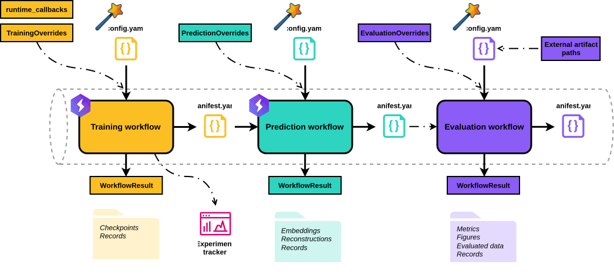
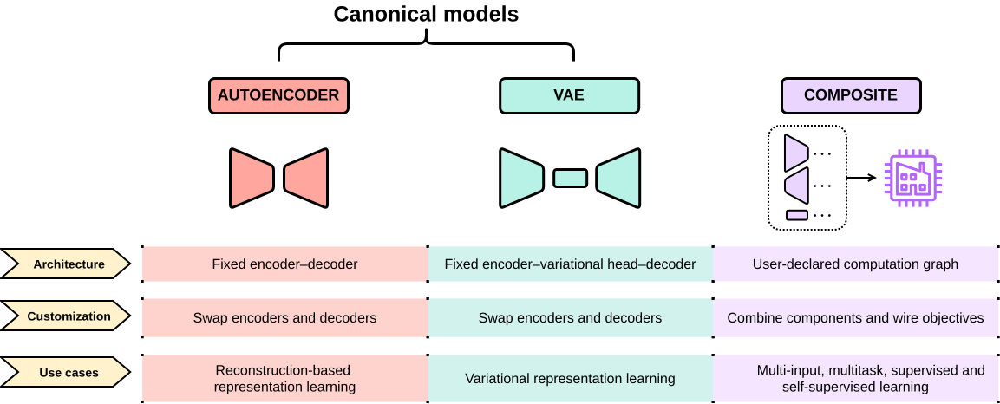
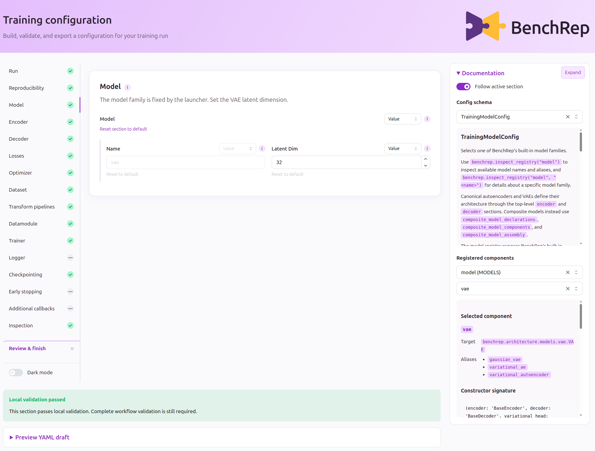

# BenchRep

BenchRep is a configuration-driven, Lightning-based, extensible **Python workbench for representation learning**. It connects model training, representation export, and standardized evaluation through reproducible, linked workflows.

> [!NOTE]
> BenchRep is an early, pre-1.0 research project under active development. APIs, schemas, contracts, and supported components may still change. BenchRep currently supports canonical autoencoder and VAE workflows alongside highly customizable composite models built from a fully user-declared computation graph, supporting supervised, self-supervised, unsupervised, and multitask architectures.

## Why BenchRep?

### Benchmarking
- Standardize your benchmarking with reusable pipelines.
- Evaluate external outputs.
- Publish traceable results.

### Experimentation
- Build custom multi-input, multitask architectures.
- Experiment with interchangeable components.
- Diagnose issues with runtime inspection and provenance.
- Automate hyperparameter tuning with Optuna.

### Education
- Teach representation learning with less coding overhead.
- Configure through YAML, Python, or GUI wizards.
- Visualize architectures.

## How it works
BenchRep separates training, prediction, and evaluation into configurable workflows linked through manifests that record comprehensive run settings. Configure each workflow through YAML, Python, or a GUI wizard. Evaluation can also run independently on external embeddings and reconstructions.

<picture>
  <source media="(prefers-color-scheme: dark)" srcset="docs/assets/workflow-chain-dark.svg">
  
</picture>

<sub>*Dash-dot arrows mark optional connections. Wands mark configuration wizards.*</sub>

BenchRep provides canonical autoencoders and VAEs with swappable encoders and decoders, alongside composite models whose components and contracts, wiring, and learning objectives are user-defined.

<picture>
  <source media="(prefers-color-scheme: dark)" srcset="docs/assets/model-families-dark.svg">
  
</picture>

BenchRep uses a registry-based system to select built-in or user-registered classes and factories for components such as datasets, transforms, architectures, losses, and evaluation methods. Workflow-specific Overrides objects provide an escape hatch for supplying supported runtime objects or replacing configuration sections.

Each workflow validates its inputs, exports artifacts and provenance records, and returns a Python result object for analysis or automation. Evaluation assesses reconstruction quality, clustering, predictability, and batch effects, producing consolidated metrics and AnnData-integrated outputs.

## Installation

BenchRep currently targets Python 3.11 or newer and is intended to be installed from source:

```bash
python -m pip install -e .
```

Optional extras include GUI wizards, Optuna tuning, scverse evaluation, external loggers, model graphs, and XGBoost probes:

```bash
python -m pip install -e ".[full]"
```

## Quick start

Run a complete VAE training, prediction, and evaluation chain using the example configurations. Run from the repository root:

```python
from pathlib import Path

from benchrep import (
    train_vae,
    predict_vae,
    evaluate,
    PredictionOverrides,
    EvaluationOverrides,
)

configs = Path("examples/configs/01_yaml_pipeline")

training_result = train_vae(config=configs / "training.yaml")

prediction_result = predict_vae(
    config=configs / "prediction.yaml",
    overrides=PredictionOverrides(
        training_manifest_path=training_result.manifest_path,
    ),
)

evaluation_result = evaluate(
    config=configs / "evaluation.yaml",
    overrides=EvaluationOverrides(
        prediction_manifest_path=prediction_result.manifest_path,
    ),
)
```

Edit the YAMLs to change the experiment settings. With the supplied YAMLs unchanged, outputs are saved under `outputs/<stage>/01_yaml_pipeline_vae_conv2d_upsample_conv2d_<timestamp>/`, where <stage> is training, prediction, or evaluation.

## Configuration wizards

Create or edit workflow configurations in your browser, with field documentation, component discovery, validation, and YAML export. Install the `gui` extra, then launch a wizard with an example base YAML:

```python
from benchrep import configure_workflow
from benchrep.interfaces.model_families import VAE_FAMILY

configured = configure_workflow(
    stage="training",
    model_family=VAE_FAMILY,
    config="examples/configs/01_yaml_pipeline/training.yaml",
)
```

The wizard opens automatically in your browser at http://127.0.0.1:8050. Use `port=...` to choose a different port.

Omit `config` to start fresh. Wizards are available for training, prediction, and evaluation; they configure workflows without running them.

<picture>
  <source media="(prefers-color-scheme: dark)" srcset="docs/assets/configuration-wizard-dark.png">
  
</picture>


## Documentation and examples

- [Documentation](docs/index.md): currently being written. For now, refer to [Usage examples](examples/usage/). 
- [Usage examples](examples/usage/): YAML and Python configuration, custom components, composite models, and Optuna tuning.
- [Example configurations](examples/configs/): starting points for your own experiments.