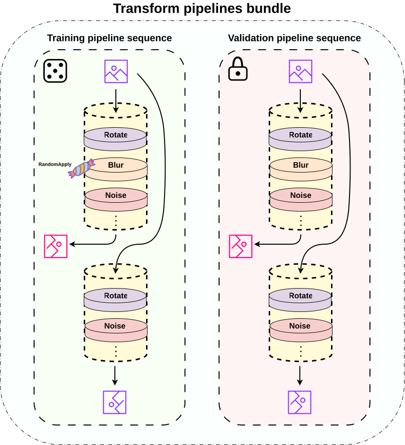
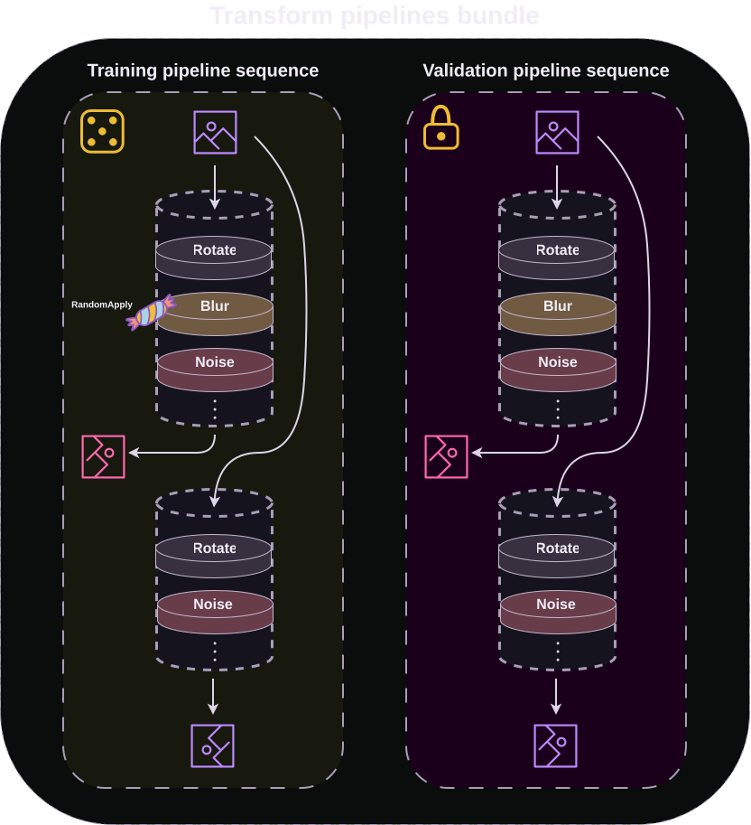

# Transform pipelines

Transform pipelines separate preprocessing and augmentation from the dataset implementation. Each pipeline reads a tensor from a sample field, applies an ordered sequence of steps, and writes the result to a sample field. Training and validation can share preprocessing while using different augmentations.

## Steps, pipelines, sequences, and bundles

<figure>
  <a class="br-image-light" href="../../assets/concepts/data/transform-structure-light.svg">
    
  </a>
  <a class="br-image-dark" href="../../assets/concepts/data/transform-structure-dark.svg">
    
  </a>

<figcaption>
  A transform bundle contains separate training and validation pipeline sequences.
  Each pipeline applies ordered steps, which can individually be wrapped in RandomApply.
  Here, 2 pipelines derive different views from the same input field.
  Separate sequences let you restrict stochastic transforms to training;
  <strong>BenchRep does not enforce deterministic validation transforms.</strong>
</figcaption>
</figure>

The top-level config section `transform_pipelines` is a list that describes the pipelines. During training, each step's `apply_to` determines whether it enters the training sequence, validation sequence, or both. The bundle is an internal container for those 2 sequences, not another YAML section to configure.

For example, this canonical-model configuration converts and scales images for both splits, but adds random rotation only during training:

```yaml
transform_pipelines:
  - steps:
      - name: to_dtype
        params:
          dtype: float32
          scale: true
        apply_to: [training, validation]
      - name: random_rotation
        params:
          degrees: 10
        apply_to: [training]
```

`name` selects a registered transform; `params` supplies constructor arguments. `apply_to` is required for each training transform step. Filtering preserves the configured order.

Register external transforms with [`TRANSFORMS.register()`][benchrep.assembly.registries.core.Registry.register], list available transforms with [`inspect_registry("transform")`][benchrep.inspect_registry], and inspect a constructor with, for example, [`inspect_registry("transform", "to_dtype")`][benchrep.inspect_registry]. See [Registering components](../extensibility/registration.md) for details.

## Route fields through pipelines

Canonical AE/VAE workflows use the fixed route `x` to `x`. Omit both `input` and `output`, as above, or explicitly set both to `x`.

Composite workflows can route between fields whose [declared roles](../models/composite.md) are image-valued under `composite_model_declarations.expects`. If exactly 1 input has the role `sample_image`, an omitted pipeline input resolves to that field. Otherwise, specify `input`. An omitted `output` uses the effective input name.

For a composite model declaring `image` and `augmented_image` as image-valued inputs, a pipeline could create the second view:

```yaml
transform_pipelines:
  - input: image
    output: augmented_image
    steps:
      - name: random_rotation
        params:
          degrees: 10
        apply_to: [training, validation]
```

The resolver checks that both route names are declared and image-valued. At runtime, the input field must already exist; the output can create a new field or <strong class="highlight">overwrite an existing one without warning</strong>. Routing does not currently apply to arbitrary scalar targets or metadata fields.

<strong class="highlight">Pipelines and their steps run in their configured list order against the current sample state, so later pipelines read values written by earlier ones.</strong> When input and output differ, BenchRep clones the input tensor before transforming it, preserving the source field. Other fields remain in the sample dictionary.

!!! tip "Creating multiple views"
    To derive several views from the same source, route each pipeline from that source into a different output field. If an earlier pipeline overwrites the source, later views use the overwritten value. Ensure every split that needs a derived field includes the steps that create it.

## Control when a step runs

`apply_to` selects the split; `random_apply` controls the probability of executing the step each time a sample is read:

```yaml
- name: gaussian_blur
  params:
    kernel_size: 3
  random_apply: 0.2
  apply_to: [training]
```

The default `random_apply: 1.0` always calls the transform. Below 1, BenchRep wraps that individual step in torchvision's `RandomApply`; skipping it passes the tensor through unchanged. This is separate from randomness inside the transform itself, including any probability in its `params`.

Transforms are applied when samples are accessed, rather than once to a stored, preprocessed dataset. Repeated reads can therefore produce different augmentations. A validation-targeted step can also be random: BenchRep does not automatically make validation transforms deterministic.

## Prediction inherits validation processing

With a config-built prediction datamodule, prediction's `transform_pipelines` controls whether to reuse or replace training-time processing:

| Prediction value | Behavior |
| --- | --- |
| Omitted or `null` | Inherit training steps whose `apply_to` includes `validation` |
| `[]` | Apply no configured transform pipelines |
| A nonempty list | Use the supplied pipelines instead of inherited ones |

Inherited steps retain their order, routing, parameters, and `random_apply` probability. Prediction steps have no `apply_to` field because there is only 1 prediction sequence. If training used an external datamodule, its internal transforms cannot be recovered this way; omitted prediction pipelines then mean no configured transforms.

Validation-targeted steps remain available for inheritance even if training used `val_fraction: 0`. Inheritance reuses the processing instructions, not the training validation subset; see [Prediction data](datamodules.md#prediction-data).

## Runtime implementation

The data builder instantiates registered transforms as [`TransformStep`][benchrep.architecture.data.transforms.TransformStep] objects and groups them into [`TransformPipeline`][benchrep.architecture.data.transforms.TransformPipeline] objects. [`TransformedDataset`][benchrep.architecture.data.datasets.TransformedDataset] wraps a dataset and performs field lookup, pipeline execution, and output assignment inside [`__getitem__()`][benchrep.architecture.data.datasets.TransformedDataset]. [`BenchRepDataModule`][benchrep.architecture.data.datamodule.BenchRepDataModule] applies the appropriate wrapper to each subset.

A supplied datamodule owns its own preprocessing, so workflow-configured transform pipelines are bypassed. When constructing a [`BenchRepDataModule`][benchrep.architecture.data.datamodule.BenchRepDataModule] directly, you can supply pipeline objects through its `training_pipelines`, `validation_pipelines`, and `prediction_pipelines` arguments. See [Datasets and transforms](../../reference/interfaces.md#datasets-and-transforms) and [Datamodules](../../reference/interfaces.md#datamodules) for these Python interfaces.
