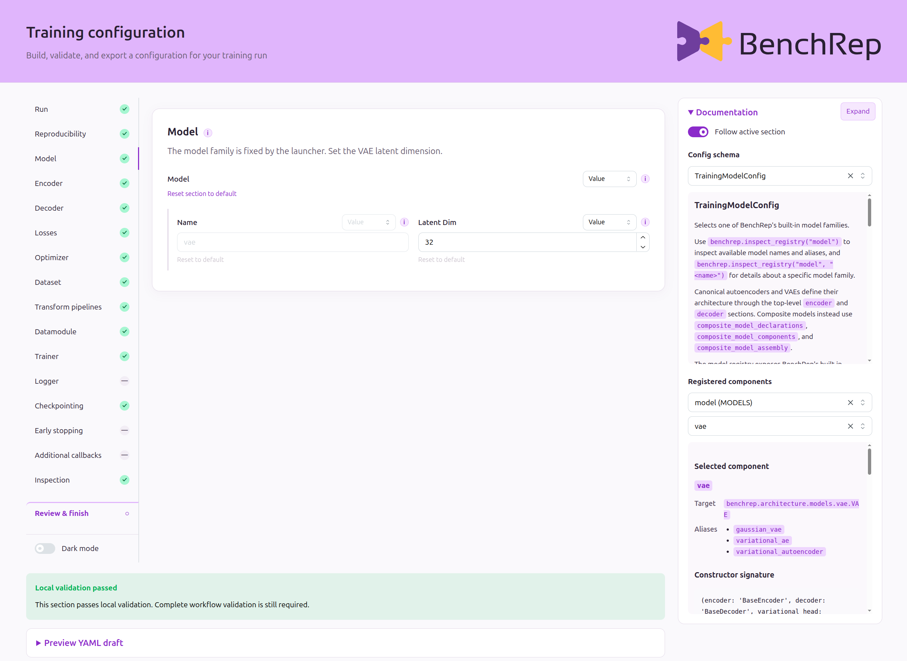
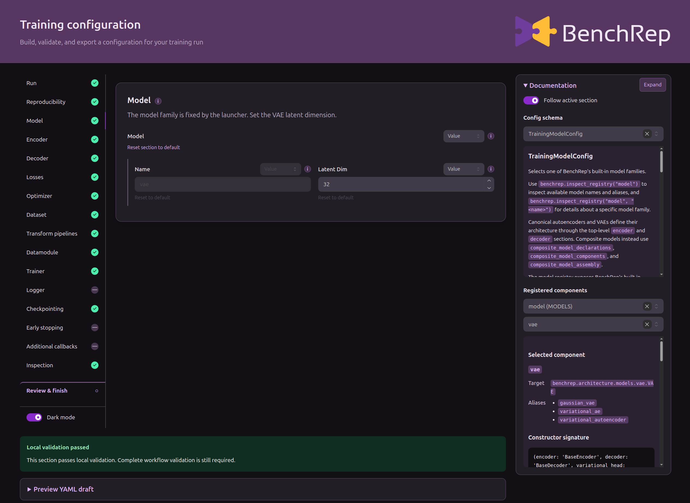
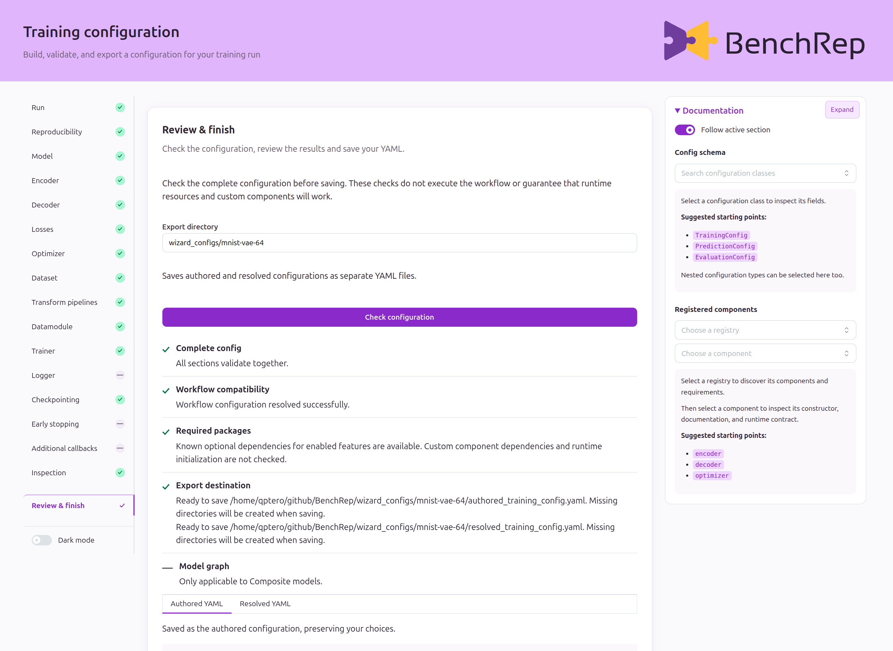
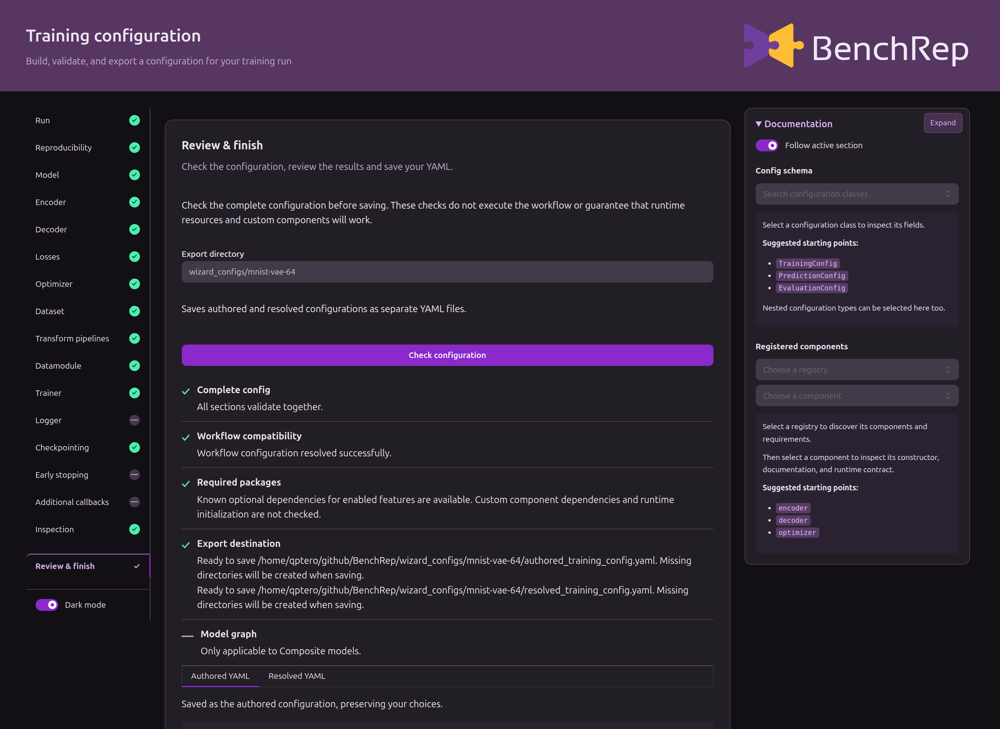
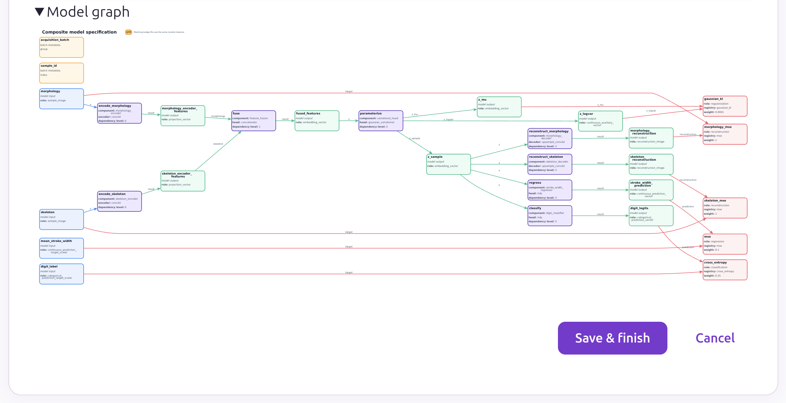
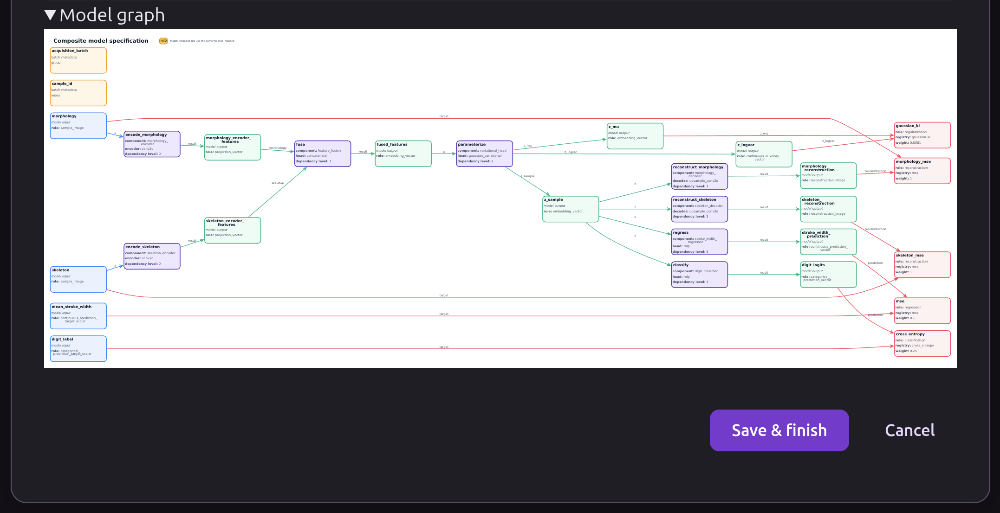

# Configuration wizards

The wizard provides a graphical, interactive way to configure a workflow, with integrated documentation and sections tailored to the chosen model family. You can explore fields, inspect registered components, and check how choices fit together before running. It edits the same configuration accepted by the Python entrypoints, which you can also write directly in YAML or Python.

The wizard **authors and reviews** a configuration; it does not train, predict, or evaluate. For a runnable walkthrough, see [Configure workflows](../../guides/configure-workflows/index.md#browser-wizard).

## Start from a draft or a blank configuration

[`configure_workflow()`][benchrep.configure_workflow] accepts a stage, an optional base config, and an optional overrides object. A base YAML can be incomplete or contain invalid entries: opening it for editing does not require a successful workflow run or a fully valid draft.

For training and prediction, the launcher's `model_family` controls which model sections are appropriate. It defaults to composite; use [`AUTOENCODER_FAMILY`](../../reference/interfaces.md#model-families) or [`VAE_FAMILY`](../../reference/interfaces.md#model-families) for a canonical model. The family is fixed for that wizard session, so an incompatible model name or section in the base YAML is flagged rather than silently changing families. Evaluation has no model family.

The launcher starts a local server and normally opens the browser at <http://127.0.0.1:8050>. The calling Python script waits until you finish or cancel; `port` and `open_browser` control the browser connection.

## Edit with the schema beside you

The editor organizes fields by section. Its **Documentation** panel follows the selected section and exposes schema descriptions, registered components, aliases, and constructor signatures. **Preview YAML draft** shows the current authored settings as YAML.

<figure>
  <a class="br-image-light" href="../../assets/configuration-wizard-light.png">
    
  </a>
  <a class="br-image-dark" href="../../assets/configuration-wizard-dark.png">
    
  </a>
  <figcaption>The editor and discovery panel expose the configuration and its documentation together.</figcaption>
</figure>

Field menus distinguish **Omit**, **Null**, **Empty**, and **Value** where supported. These preserve different authored choices; their effects are defined by the field, as explained in [Configuration semantics](configuration.md#omitted-null-and-empty-are-different-inputs).

The sidebar marks local validity in green, issues in red, and valid omitted or null sections with a neutral dash. Unexpected fields or sections remain visible so you can remove them. These indicators describe the current **local state**, not whether the complete experiment is executable.

## Review the complete configuration

**Review & finish → Check configuration** evaluates the draft as a whole:

| Check | What it establishes                                                                                                                                    |
| --- |--------------------------------------------------------------------------------------------------------------------------------------------------------|
| Schema validation | The composed draft satisfies the workflow schema and its field compatibility rules (e.g. through [`TrainingConfig.model_validate()`][benchrep.assembly.schemas.training_config_schema.TrainingConfig])                                                     |
| Resolution | Sections, selected components, upstream settings, and runtime override requirements form a coherent workflow (e.g. through `resolve_training_config()`) |
| Dependencies | Known dependencies for enabled features are available; missing dependencies are reported (e.g. Torchview and Graphviz for model graph export)          |
| Export destination | The authored and resolved YAMLs have valid save locations without overwriting existing files                                                           |

A collection of locally valid sections can still fail here. Changes to the draft or export settings require another check before saving.

<figure>
  <a class="br-image-light" href="../../assets/guides/configuration-wizard/review-and-finish-light.png">
    
  </a>
  <a class="br-image-dark" href="../../assets/guides/configuration-wizard/review-and-finish-dark.png">
    
  </a>
<figcaption>Review separates the validation results from the authored and resolved YAML previews.</figcaption>
</figure>

The **Authored YAML** preserves the choices in the draft, including omissions and explicit nulls. The **Resolved YAML** shows the interpretation produced during review. For composite configurations, review can also preview the specification graph to inspect declared wiring without constructing or training the model; this requires Graphviz.

<figure>
  <a class="br-image-light" href="../../assets/configuration-wizard-composite-spec-graph-light.png">
    
  </a>
  <a class="br-image-dark" href="../../assets/configuration-wizard-composite-spec-graph-dark.png">
    
  </a>

<figcaption>
  Model specification preview for the
  <a href="https://github.com/uhlmanngroup/BenchRep/blob/main/examples/usage/08B_dual_input_multitask_composite_vae_wizard.py">composite wizard example</a>,
  available before training.
</figcaption>
</figure>

??? note "What a successful review does not guarantee"
    Review does not instantiate and exercise every component. It cannot establish that all custom dependencies are available, that real batches satisfy every runtime expectation, or that the run will fit in memory. Some optional outputs, such as an unavailable graph preview, can produce a warning without blocking configuration export. Execution still performs its own checks.

## Save and continue in Python

**Save & finish** writes authored and resolved YAMLs and returns a [`ConfiguredWorkflow`][benchrep.gui.shared.results.ConfiguredWorkflow]. **Cancel** returns `None`.

| Returned value | Use |
| --- | --- |
| `config` and `overrides` | Execute the configured workflow in the current Python process |
| `config_path` | Run later from the saved authored YAML, supplying any required runtime objects again |
| `authored_config` | Inspect the authored mapping, including omitted versus explicit values |
| `resolved_config` and `resolved_config_path` | Inspect the interpretation produced during review |

After a training wizard launched for the VAE family, the same script can continue with:

```python
from benchrep import train_vae

if wizard_result is not None:
    training_result = train_vae(
        config=wizard_result.config,
        overrides=wizard_result.overrides,
    )
```

!!! tip "Which config should you use?"
    Prefer the authored configuration for subsequent runs: it preserves instructions such as selecting the best checkpoint or inheriting upstream settings. For example, resolution replaces `checkpoint: best` with an absolute checkpoint path; reusing the resolved YAML keeps that specific path rather than selecting the best checkpoint for the next run.

## Overrides enter and leave the wizard

The wizard accepts the same workflow-specific override bundles described in [Python overrides](overrides.md). Supplying them upfront lets it account for runtime implementations and upstream runs when determining which sections need configuration and checking the draft. For example, pass [`overrides=PredictionOverrides(training_manifest_path=training_result.manifest_path)`][benchrep.PredictionOverrides] to review a prediction config against the run you just trained.

Section overrides become part of the editable draft and are removed from the returned override bundle. Other inputs needed at execution, like runtime objects and supplied manifest overrides, are retained. Forwarding both [`wizard_result.config`][benchrep.gui.shared.results.ConfiguredWorkflow]
 and [`wizard_result.overrides`][benchrep.gui.shared.results.ConfiguredWorkflow] preserves that combination without re-applying config replacements.

For how the editor preserves draft state and manages review internally, see [How the wizard works](../internals/wizard-architecture.md).
