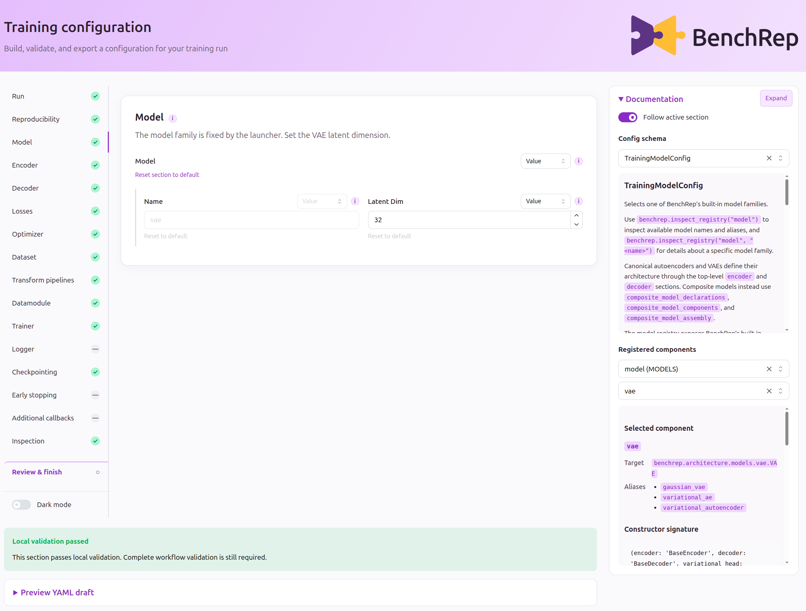
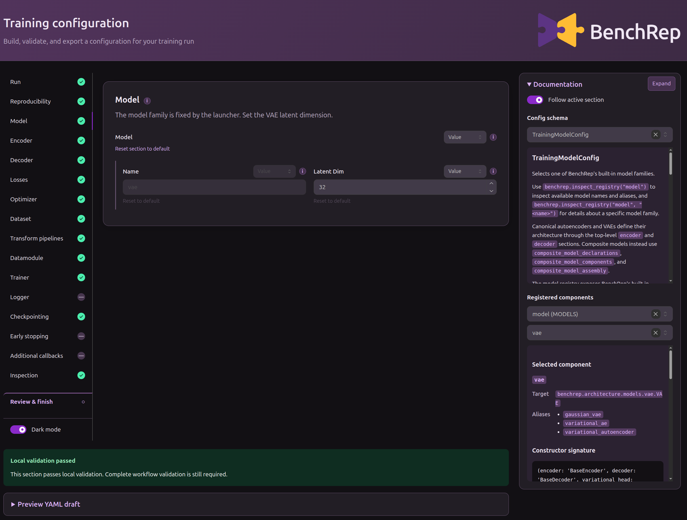

# Configure workflows

There are several ways to configure a BenchRep workflow. You can edit a YAML, build or update a config object in Python, replace sections through overrides, or use the browser wizard. The workflow function you call, such as `train_vae()`, accepts a YAML path or a config object through its `config` argument.

| Route | Configure the run by… |
|---|---|
| [YAML](#yaml-files) | Editing a file and passing its path |
| [Python config objects](#python-config-objects) | Constructing a config or updating an existing one |
| [Python overrides](#python-overrides) | Replacing whole sections alongside a base config |
| [Browser wizard](#browser-wizard) | Editing fields interactively, reviewing, and saving |

The snippets below are alternatives: each changes the [first tutorial’s](../first-workflow-chain.md) MNIST VAE latent dimension from 32 to 64. Each route also links to a complete runnable example demonstrating the logic, though each script uses its own settings.

<strong class="highlight">Requirements.</strong> The YAML and Python snippets need the core installation; the wizard needs `gui`. The complete example chains also use `scverse`. See [Installation](../installation.md) to choose extras. The composite wizard example additionally needs `artifact_generation` for its custom dataset.

## YAML files

Copy the packaged training YAML to your working directory:

```python
from pathlib import Path
from shutil import copyfile

from benchrep.examples import example_config_path

training_yaml = Path("configs/mnist-vae-64/training.yaml")
training_yaml.parent.mkdir(parents=True, exist_ok=True)
copyfile(
    example_config_path("01_yaml_pipeline", stage="training"),
    training_yaml,
)
```

Change the existing `model` section in that file:

```yaml
model:
  name: vae
  params:
    latent_dim: 64
```

Then pass its path to training:

```python
from benchrep import train_vae

training_result = train_vae(config=training_yaml)
```

!!! note "Encoder output and latent dimensions"
    Keep `encoder.params.output_dim` at `32`. The variational head maps those 32 features to the mean and log variance of the 64-dimensional latent distribution. BenchRep sets the decoder input dimension to `64` automatically.

For the complete YAML-based chain with its original 32-dimensional latent space, run:

```bash
python -m benchrep.examples.usage.01_yaml_pipeline
```

[View the script](https://github.com/uhlmanngroup/BenchRep/blob/main/examples/usage/01_yaml_pipeline.py).

## Python config objects

`load_example_config()` reads a packaged YAML into its workflow config class. Use `update_config()` to replace individual fields and return a validated copy:

```python
from benchrep import train_vae, update_config
from benchrep.examples import load_example_config

base = load_example_config("01_yaml_pipeline", stage="training")
config = update_config(base, {"model.params.latent_dim": 64})

print(base.model.params["latent_dim"])    # 32
print(config.model.params["latent_dim"])  # 64

training_result = train_vae(config=config)
```

!!! note "Local YAML?"
    To start from your own training YAML, replace the `base = load_example_config(...)` line with:

    ```python
    import yaml
    from benchrep.assembly.schemas import TrainingConfig

    with open("configs/mnist-vae-64/training.yaml", encoding="utf-8") as stream:
        base = TrainingConfig.model_validate(yaml.safe_load(stream))
    ```

You can also construct `TrainingConfig`, `PredictionConfig`, or `EvaluationConfig` entirely in Python. For example, a typed model section is constructed as:

```python
from benchrep.assembly.schemas import TrainingModelConfig

model = TrainingModelConfig(name="vae", params={"latent_dim": 64})
```

Pass that section as `model=model` when constructing `TrainingConfig`, together with the other required sections. The [Python-only example](https://github.com/uhlmanngroup/BenchRep/blob/main/examples/usage/03_config_object_pipeline.py) constructs all 3 workflow configs in full, using its original 32-dimensional latent space:

```bash
python -m benchrep.examples.usage.03_config_object_pipeline
```

See [Configuration semantics](../../understanding/workflows/configuration.md) for field updates, defaults, and validation.

## Python overrides

To replace an entire section while keeping the base YAML, pass a workflow-specific overrides object:

```python
from benchrep import TrainingOverrides, train_vae
from benchrep.assembly.schemas import TrainingModelConfig
from benchrep.examples import example_config_path

model = TrainingModelConfig(
    name="gaussian_vae",
    params={"latent_dim": 64},
)

training_result = train_vae(
    config=example_config_path("01_yaml_pipeline", stage="training"),
    overrides=TrainingOverrides(config_components={"model": model}),
)
```

The supplied section replaces the <strong class="highlight">entire `model` section</strong>. Omitted fields take their schema defaults; required fields still need values. Here, `gaussian_vae` is an alias for `vae`, so it matches the family expected by `train_vae()`.

The base can also be a config object. You can omit `config` if `config_components`, together with defaults, supplies a valid workflow config. Manifest paths and supported runtime model/datamodule implementations can also be supplied through overrides; see [Python overrides](../../understanding/workflows/overrides.md).

The complete overrides example adapts the MNIST pipeline to CIFAR-10 by replacing the dataset and architecture sections:

```bash
python -m benchrep.examples.usage.02_yaml_override_pipeline
```

[View the script](https://github.com/uhlmanngroup/BenchRep/blob/main/examples/usage/02_yaml_override_pipeline.py).

## Browser wizard

Launch the training wizard with the packaged YAML as a starting point:

```python
from benchrep import configure_workflow, train_vae
from benchrep.examples import example_config_path
from benchrep.interfaces.model_families import VAE_FAMILY

wizard_result = configure_workflow(
    stage="training",
    model_family=VAE_FAMILY,
    config=example_config_path("01_yaml_pipeline", stage="training"),
    export_directory="wizard_configs/mnist-vae-64",
)

if wizard_result is not None:
    training_result = train_vae(
        config=wizard_result.config,
        # Forward any overrides still needed at runtime; empty in this example.
        overrides=wizard_result.overrides,
    )
```

!!! note "Starting without a base config"
    Omit `config` to start from scratch. You only need to specify `stage`. For training and prediction, the wizard assumes a composite model unless you choose a different `model_family`. Set it explicitly to choose another family and show its compatible configuration sections.

The launcher opens your browser at <http://127.0.0.1:8050> by default; pass `port=...` to change it. The Python call waits while you edit and returns when you save or cancel. The launcher's `model_family` fixes the family, even if the base YAML names another one.

Select **Model**, change **Latent Dim** to `64`, and inspect **Preview YAML draft**. The **Documentation** panel shows schemas and registered components. The screenshot shows the starting configuration, before the edit.

<figure>
  <a class="br-image-light" href="../../assets/configuration-wizard-light.png">
    
  </a>
  <a class="br-image-dark" href="../../assets/configuration-wizard-dark.png">
    
  </a>
  <figcaption>Click the screenshot to view it at full resolution.</figcaption>
</figure>

Open **Review & finish**, click **Check configuration**, then **Save & finish**. Review performs workflow-level validation and resolution, including known dependency checks. Saving writes authored and resolved YAMLs and returns the config to your script; **Cancel** returns `None`.

The wizard accepts an `overrides` argument and returns the overrides still needed for execution. This also lets you pass upstream manifest paths when configuring prediction or evaluation. See [Configuration wizards](../../understanding/workflows/wizards.md) for editing states, local validation, review, and returned values.

For a complete chain configured through 3 wizard sessions, run the composite example. It uses a different, multi-input model and a custom dataset:

```bash
python -m benchrep.examples.usage.08B_dual_input_multitask_composite_vae_wizard
```

[View the script](https://github.com/uhlmanngroup/BenchRep/blob/main/examples/usage/08B_dual_input_multitask_composite_vae_wizard.py).

## Check the effective settings

After any of the training snippets, inspect the saved resolved config:

```python
print(training_result.run_context.config_dir / "resolved_config.yaml")
```

Confirm that `model.params.latent_dim` is `64`. Prediction and evaluation can reuse the packaged YAMLs and manifest-linking code from the [first workflow chain](../first-workflow-chain.md), regardless of how you configured training.
