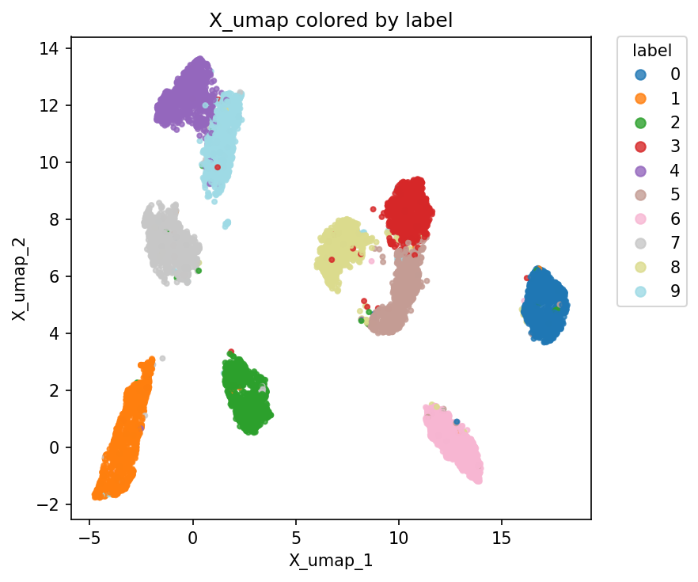
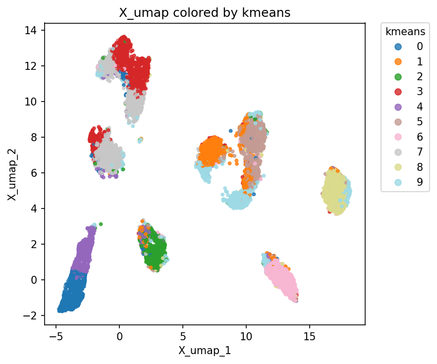
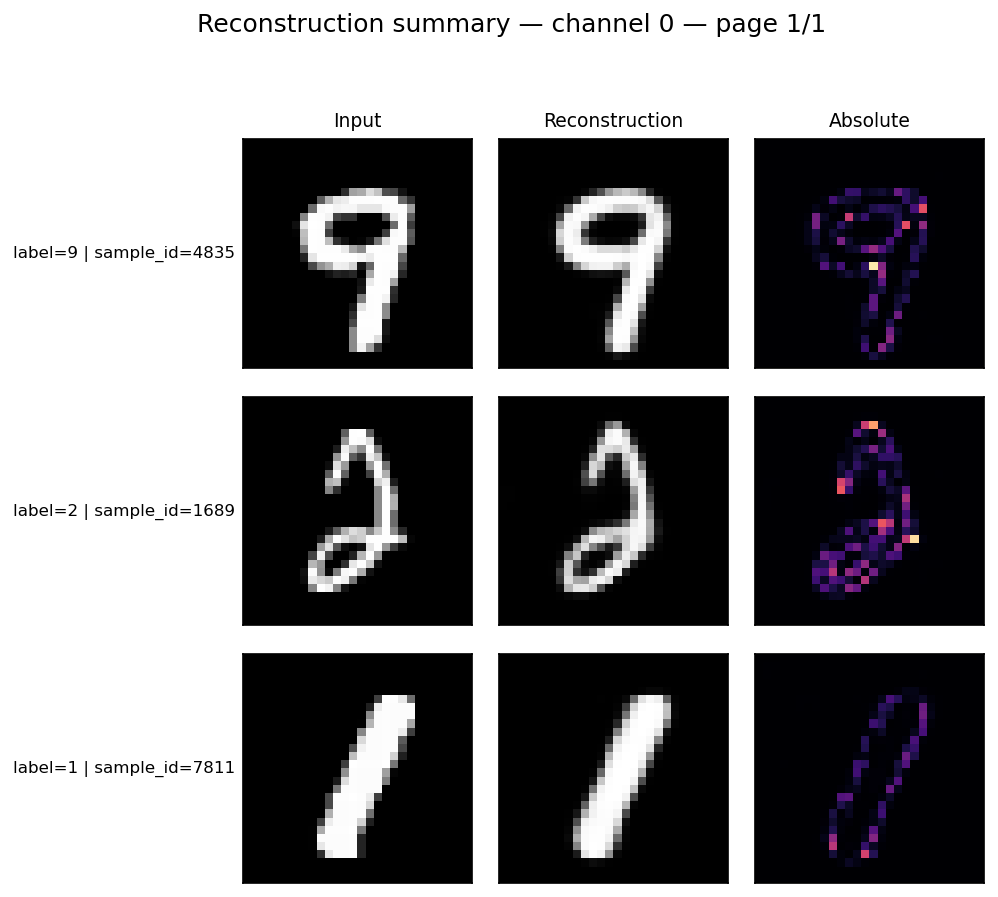

# Run your first workflow chain

Train a convolutional variational autoencoder (VAE) on MNIST, then examine its learned representation. <strong class="highlight">Do images of the same digit cluster together?</strong> You’ll run 3 workflows, each with its own YAML. Training fits the model, prediction exports embeddings and reconstructions, and evaluation scores them.

<strong class="highlight">Requirements.</strong> This example uses the `scverse` extra for UMAP. If you installed the full or development dependencies, you’re ready. Otherwise, run:

```bash
python -m pip install "benchrep[scverse] @ git+https://github.com/uhlmanngroup/BenchRep.git"
```

## Run the example

From the directory where you want to keep your data and outputs, run:

```bash
python -m benchrep.examples.usage.01_yaml_pipeline
```

The first run downloads MNIST to `data/mnist/` (~64 MiB). The script prints each manifest path and all 3 output directories.

| Workflow | What the supplied YAML does |
| --- | --- |
| Training | Trains a VAE with a 32-dimensional latent space for up to 5 epochs, holding out 10% of the training split for validation. Saves the checkpoint with the lowest total weighted validation loss. |
| Prediction | Loads the best checkpoint and runs it on the test split. Exports embeddings as AnnData (`.h5ad`) and saves 32 input–reconstruction pairs. |
| Evaluation | Runs PCA, UMAP, and k-means, compares the 10 clusters with the digit labels, and measures reconstruction error on the exported examples. |

## How the workflows connect

As an alternative to the terminal command, run the same chain in Python:

```python
from benchrep import (
    EvaluationOverrides,
    PredictionOverrides,
    evaluate,
    predict_vae,
    train_vae,
)
from benchrep.examples import example_config_path

example = "01_yaml_pipeline"

training_result = train_vae(
    config=example_config_path(example, stage="training")
)

prediction_result = predict_vae(
    config=example_config_path(example, stage="prediction"),
    overrides=PredictionOverrides(
        training_manifest_path=training_result.manifest_path,
    ),
)

evaluation_result = evaluate(
    config=example_config_path(example, stage="evaluation"),
    overrides=EvaluationOverrides(
        prediction_manifest_path=prediction_result.manifest_path,
    ),
)
```

The prediction YAML specifies `checkpoint: best` and leaves the training manifest path open. Passing `training_result.manifest_path` tells prediction **which training run** to load that checkpoint from. Evaluation uses `prediction_result.manifest_path` to locate the exported embeddings and reconstructions. This lets you reuse the same YAMLs across runs.

## Inspect the result

Open `figures/anndata/` in the evaluation output directory printed by the script. The panels show the same UMAP projection of the test embeddings, colored by digit label (left) and k-means assignment (right).

| Digit label | K-means cluster |
| :---: | :---: |
| [](../assets/guides/first-workflow-chain/mnist-umap-label.png) | [](../assets/guides/first-workflow-chain/mnist-umap-kmeans.png) |

<small class="br-caption">Each point represents one MNIST test image.</small>

External clustering metrics in `records/metrics/metrics.json` include adjusted mutual information (AMI), adjusted Rand index (ARI), and homogeneity. From Python, retrieve AMI directly from the evaluation result:

```python
ami = evaluation_result.get_metric(
    "clustering", "external", "kmeans", "metrics", "adjusted_mutual_info", "value"
)
print(f"Clustering AMI: {ami:.3f}")
```

The panel below shows selected test inputs, their VAE reconstructions, and the corresponding absolute-error maps. Reconstruction panels can be found in the `figures/reconstructions` directory.

[](../assets/guides/first-workflow-chain/mnist-reconstructions.png)

<small class="br-caption">Click the figure to view all 32 examples.</small>

To change the experiment, see [Configure workflows](configure-workflows/index.md) for the YAML, Python, override, and wizard routes.
