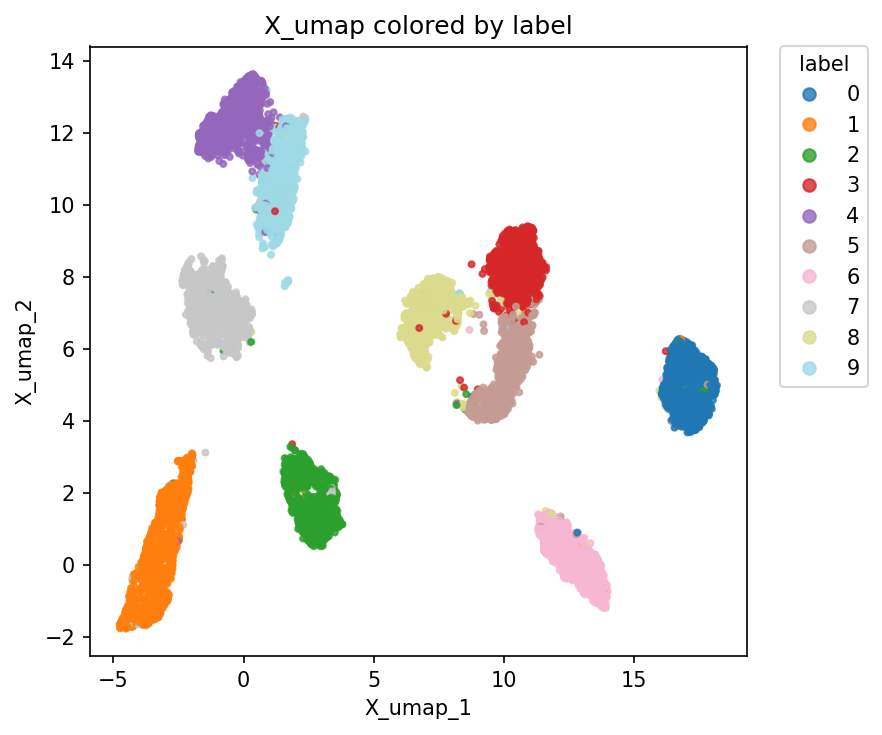
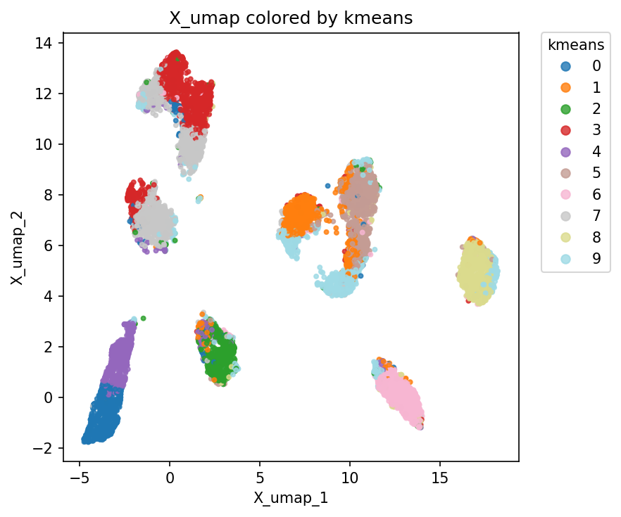
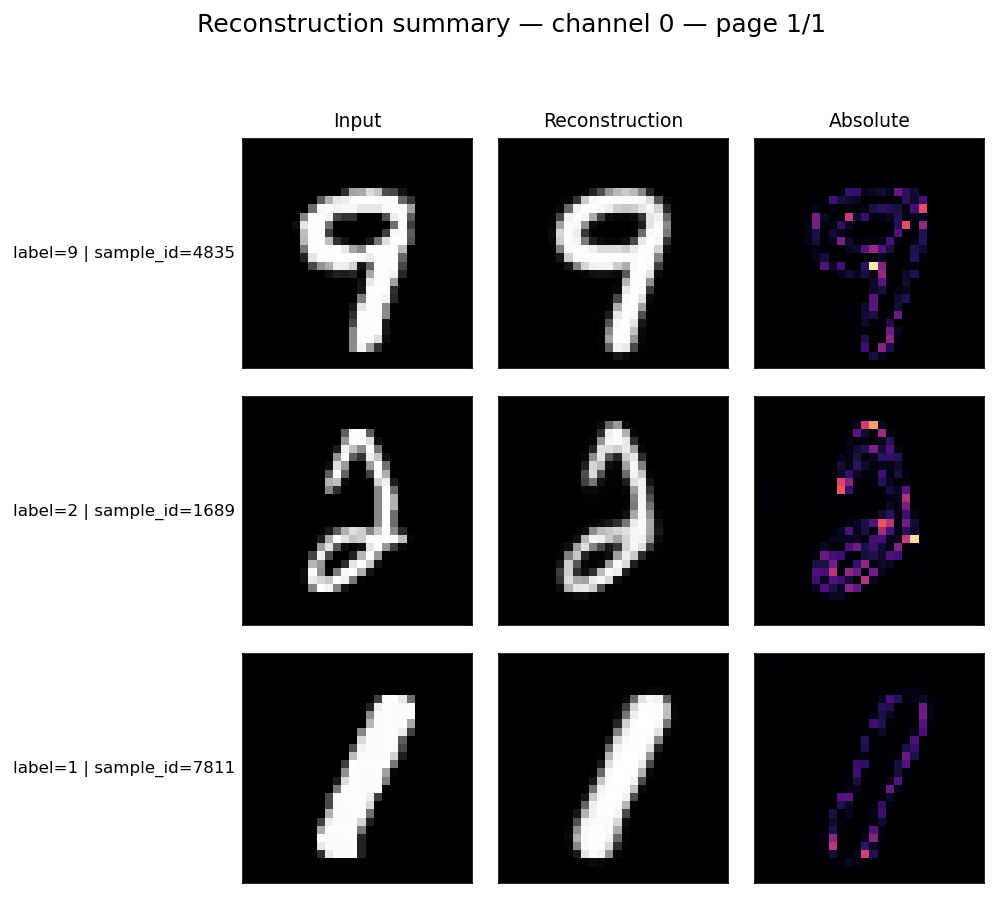

# Run your first workflow chain

<strong class="highlight">Do images of the same digit cluster together in a VAE’s learned representation?</strong> We’ll investigate this by training a convolutional variational autoencoder (VAE) on [MNIST](http://yann.lecun.com/exdb/mnist/) and examining its embeddings.

One runnable example connects BenchRep’s 3 workflows, each configured through its own YAML. Training fits the model, prediction exports embeddings and reconstructions, and evaluation computes metrics and produces figures. The terminal command and the Python snippet run the same chain.

[:material-script-text-outline: View script](https://github.com/uhlmanngroup/BenchRep/blob/main/src/benchrep/examples/usage/01_yaml_pipeline.py){ .md-button }
[:material-file-cog-outline: View configs](https://github.com/uhlmanngroup/BenchRep/tree/main/src/benchrep/examples/configs/01_yaml_pipeline){ .md-button }
{: .br-tutorial-resources }

<strong class="highlight">Requirements.</strong> This example uses the `scverse` extra for UMAP. If you installed the full or development dependencies, you’re ready. Otherwise, run:

```bash
python -m pip install "benchrep[scverse] @ git+https://github.com/uhlmanngroup/BenchRep.git"
```

## Run the example

From the directory where you want to keep your data and outputs, run:

```bash
python -m benchrep.examples.usage.01_yaml_pipeline
```

The first run downloads MNIST to `data/mnist/` (~64 MiB on disk). The script prints each manifest path and all 3 output directories.

| Workflow | What the supplied YAML does |
| --- | --- |
| Training | Trains a VAE with a 32-dimensional latent space for up to 5 epochs, holding out 10% of the training split for validation. Saves the checkpoint with the lowest total weighted validation loss. |
| Prediction | Loads the best checkpoint and runs it on the test split. Exports embeddings as AnnData (`.h5ad`) and saves 32 input–reconstruction pairs. |
| Evaluation | Runs PCA, UMAP, and k-means with 10 clusters. Compares the clusters with digit labels, tests how well the embeddings predict those labels, and measures reconstruction error. |

## How the workflows connect

As an alternative to the terminal command, run the same chain in Python:

```python
from benchrep import (
    EvaluationOverrides,
    PredictionOverrides,
    evaluate,
    predict_vae,
    train_vae,
)
from benchrep.examples import example_config_path

example = "01_yaml_pipeline"

training_result = train_vae(
    config=example_config_path(example, stage="training")
)

prediction_result = predict_vae(
    config=example_config_path(example, stage="prediction"),
    overrides=PredictionOverrides(
        training_manifest_path=training_result.manifest_path,
    ),
)

evaluation_result = evaluate(
    config=example_config_path(example, stage="evaluation"),
    overrides=EvaluationOverrides(
        prediction_manifest_path=prediction_result.manifest_path,
    ),
)
```

!!! note "Running BenchRep from a Python script"
    When the data loader uses workers (`datamodule.num_workers` for training or `data.num_workers` for prediction), use a main guard (`if __name__ == "__main__":`) to prevent recursive process spawning.

The prediction YAML specifies `checkpoint: best` and leaves the training manifest path open. Passing [`training_result.manifest_path`][benchrep.workflows.train.TrainingWorkflowResult] tells prediction **which training run** to load that checkpoint from. Evaluation uses [`prediction_result.manifest_path`][benchrep.workflows.predict.PredictionWorkflowResult] to locate the exported embeddings and reconstructions. This lets you reuse the same YAMLs across runs.

## Inspect the result

Open `figures/anndata/` in the evaluation output directory printed by the script. The panels show the same UMAP projection of the test embeddings, colored by digit label (left) and k-means assignment (right).

<figure>
  <table>
    <thead>
      <tr>
        <th>Digit label</th>
        <th>K-means cluster</th>
      </tr>
    </thead>
    <tbody>
      <tr>
        <td>
          <a href="../assets/guides/first-workflow-chain/mnist-umap-label.png">
            
          </a>
        </td>
        <td>
          <a href="../assets/guides/first-workflow-chain/mnist-umap-kmeans.png">
            
          </a>
        </td>
      </tr>
    </tbody>
  </table>
  <figcaption>Each point represents one MNIST test image.</figcaption>
</figure>

External clustering metrics in `records/metrics/metrics.json` include adjusted mutual information (AMI), adjusted Rand index (ARI), and homogeneity. From Python, retrieve AMI directly from the evaluation result:

```python
ami = evaluation_result.get_metric(
    "clustering", "external", "kmeans", "metrics", "adjusted_mutual_info", "value"
)
print(f"Clustering AMI: {ami:.3f}")
```

The panel below shows selected test inputs, their VAE reconstructions, and the corresponding absolute-error maps. Reconstruction panels can be found in the `figures/reconstructions` directory.

<figure>
  <a href="../assets/guides/first-workflow-chain/mnist-reconstructions.png">
    
  </a>
  <figcaption>Click the figure to view the full panel.</figcaption>
</figure>

To change the experiment, see [Configure workflows](configure-workflows/index.md) for the YAML, Python, override, and wizard routes.
