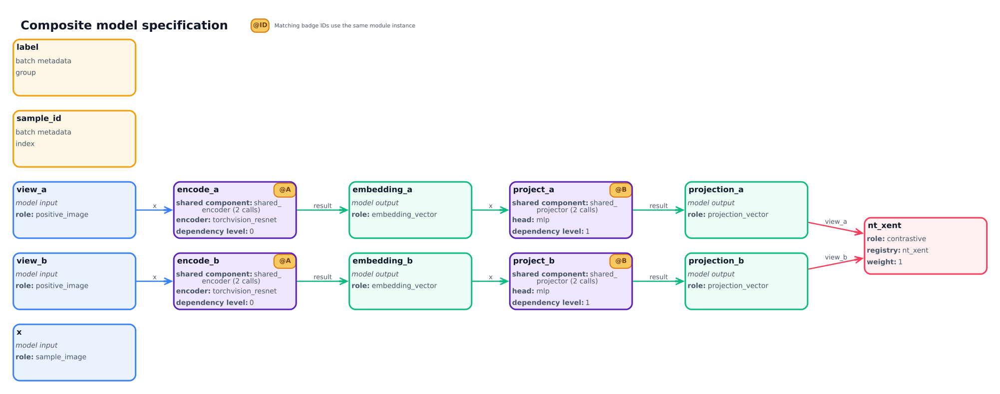
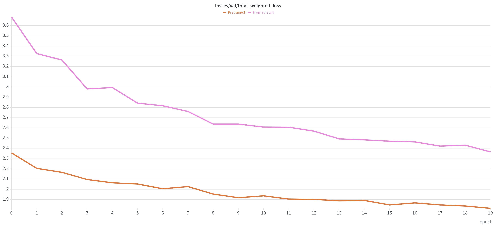
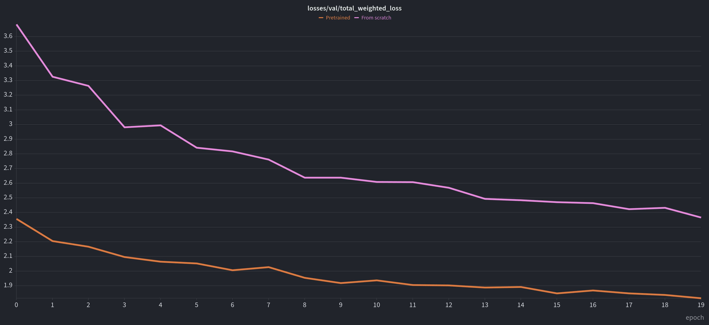

# Learn from multiple views

<strong class="highlight"> Under the same training budget, does an ImageNet-pretrained ResNet learn a better representation of [STL-10][benchrep.architecture.data.datasets.STL10Dataset] than if initialized randomly?</strong> We can test this by training both variants under a self-supervised contrastive learning paradigm, running prediction and evaluation on their embeddings with identical settings.

This tutorial uses a composite model with a shared encoder and projection head. Two independently augmented views of each image form a positive pair, while views of other images in the batch serve as negatives. This follows the multiview contrastive approach used in [SimCLR](https://arxiv.org/abs/2002.05709).

The [:material-script-text-outline: complete script](https://github.com/uhlmanngroup/BenchRep/blob/main/examples/usage/07_learn_from_multiple_views.py) and [YAMLs](https://github.com/uhlmanngroup/BenchRep/tree/main/examples/configs/07_learn_from_multiple_views) implement the comparison. The sections below explain the decisions behind them.

## Define the comparison

Both variants are trained with [NT-Xent][benchrep.architecture.losses.contrastive.NTXentContrastiveLoss]. ***From scratch*** starts with random weights while ***Pretrained*** starts with ImageNet backbone weights. Their architectures, augmentations, optimizer settings, split seed, and training budget are the same.

| File | Purpose                                                                               |
| --- |---------------------------------------------------------------------------------------|
| `training.yaml` | Train the *From scratch* variant                                                      |
| `training_pretrained.yaml` | Train the *Pretrained* variant                                                        |
| `prediction.yaml` | Export the same representation fields from the same labeled images for either variant |
| `evaluation.yaml` | Apply the same analyses, probe settings, and cross-validation splits                  |
| `wandb_logger.yaml` | Optional Weights & Biases configuration                                               |

[STL-10](https://cs.stanford.edu/~acoates/stl10/) contains 96 × 96 RGB images: 100,000 unlabeled images, 5,000 labeled training images, and 8,000 labeled test images. The labeled sets cover 10 classes, though the unlabeled set also includes images from other classes (additional animals and vehicles). Here we learn representations from `unlabeled`, then run cross-validated probes on `train` (`test` split is unused).

??? note "What this comparison establishes"
    This tests ImageNet initialization under a fixed fine-tuning budget. Prior training is unequal: the pretrained model received additional supervised training, and **STL-10 itself comes from ImageNet**.

    Five-fold probes on the labeled training split differ from STL-10's official protocol. For stronger conclusions, repeat across training seeds and reserve a final test set if using these results to choose settings.

## Run the example

???+ warning "Runtime and resource requirements"
    Dataset disk usage is **~5.4 GiB**; deleting the .tar.gz after extraction frees ~2.6 GiB. The intended recipe uses 20 epochs per variant, batch size 128, and limits of 128 training batches and 16 validation batches per epoch. The full unlabeled dataset is loaded into host memory despite those limits.

    To shorten the run, lower the epoch count or batch limits in **both** training YAMLs. To reduce GPU memory use, lower `datamodule.batch_size`, though smaller batches provide fewer contrastive negatives. Prediction has a separate `data.batch_size`.


Install the required extras and run the example using either logging option below. `scverse` enables UMAP and Leiden; `model_graph` enables architecture diagrams. Run from the directory where you want to keep the data and outputs.

Architecture diagrams also require the [Graphviz system executable](https://graphviz.org/download/). Without it, the example still runs but skips diagram exports with warnings. On Debian/Ubuntu:

```bash
sudo apt install graphviz
```

=== "CSV (default)"

    Save training metrics locally as CSV files.

    ```bash
    python -m pip install "benchrep[scverse,model_graph] @ git+https://github.com/uhlmanngroup/BenchRep.git"
    python -m benchrep.examples.usage.07_learn_from_multiple_views
    ```

=== "Weights & Biases"

    Compare both runs with live interactive plots. Install the extra, authenticate, and select W&B:

    ```bash
    python -m pip install "benchrep[scverse,model_graph,wandb] @ git+https://github.com/uhlmanngroup/BenchRep.git"
    wandb login
    python -m benchrep.examples.usage.07_learn_from_multiple_views --logger wandb
    ```

See [Follow training](#follow-training) for monitoring and comparing the runs.

The script runs a full workflow chain for each variant and writes a `comparison_<timestamp>.csv` under `outputs/07_learn_from_multiple_views/`. The first run downloads STL-10; the pretrained run also downloads the backbone weights.

## Configure the data pipeline

The built-in [STL-10 dataset][benchrep.architecture.data.datasets.STL10Dataset] supplies the image as `x`. Two transform pipelines read `x` and write `view_a` and `view_b`. Because the routes have different input and output names, BenchRep preserves `x` by first cloning the source tensor.

Each pipeline independently applies augmentations deemed appropriate for this dataset and learning task: **geometric augmentations** (cropping and flipping), **photometric augmentations** (color jitter and grayscale), and **Gaussian blur**, followed by floating-point conversion and normalization.

??? note "Parameter choices"
    Augmentation settings combine Torchvision defaults with choices for this example. Normalization matches the ImageNet-pretrained weights.

??? tip "Reuse YAML settings with anchors and aliases"
    `&view_steps` names the step list defined for the first pipeline; `*view_steps` reuses it in the second: this shares the **configuration**, not the random draws.

    Likewise, `T_max: &epochs 20` defines the epoch count reused by `max_epochs: *epochs`. Changing the anchored value adjusts both the training duration and cosine schedule. 

We use `datamodule.val_fraction` to reserve validation data and `trainer.limit_train_batches` / `trainer.limit_val_batches` to limit each epoch’s workload given the large size of the dataset. Note that this produces partial epochs: each epoch processes only part of the training set, with shuffling varying which samples are included. Transform steps apply to both splits through `apply_to: [training, validation]`. See [Transform pipelines](../concepts/data/transforms.md) and [Splits and dataloaders](../concepts/data/datamodules.md) for configuration details.

??? tip "What about natural pairs of images?"
    For natural pairs, have your dataset return both related images in each sample. Declare their fields as image inputs, route them through the appropriate transform pipelines and assembly steps, and wire the resulting representations to the contrastive loss. Field names are arbitrary, and both inputs can use the `sample_image` role. See [Datasets and sample structure](../concepts/data/datasets.md) and [Composite models](../concepts/models/composite.md).

## Configure the shared model

Under `composite_model_components`, we define one `shared_encoder` and one `shared_projector`. The assembly steps reference each component twice, so both views pass through **the same modules and weights**.

| Input | Encoder output | Projection-head output |
| --- | --- | --- |
| `view_a` | `embedding_a`: 512 features | `projection_a`: 128 features |
| `view_b` | `embedding_b`: 512 features | `projection_b`: 128 features |

For [`TorchvisionResNet`][benchrep.architecture.encoders.torchvision_resnets.TorchvisionResNet], `weights` selects random initialization (`null`) or pretrained ImageNet weights (`IMAGENET1K_V1`). Both variants use `small_stem: false` to retain the original ResNet input layers and keep the architectures identical:

```yaml
shared_encoder:
  kind: encoder
  name: torchvision_resnet
  params:
    input_shape: [3, 96, 96]
    variant: resnet18
    weights: IMAGENET1K_V1
    small_stem: false
    output_dim: 512
```

BenchRep's ResNet wrapper replaces the classifier with a linear output projection. Here, we add a separate [MLP projection head][benchrep.architecture.heads.mlp.MLPHead]. Both projections are initialized randomly. **All parameters are trained in both variants.**

### Wire the contrastive loss

We select the registered [NT-Xent loss][benchrep.architecture.losses.contrastive.NTXentContrastiveLoss] and use `composite_wiring` to connect its named arguments to the projection outputs:

```yaml
losses:
  contrastive:
    - name: nt_xent
      weight: 1.0
      params:
        temperature: 0.2
      composite_wiring:
        view_a: produces.projection_a
        view_b: produces.projection_b
```

The loss uses `projection_a` and `projection_b`, while prediction exports `embedding_a` and `embedding_b` for evaluation. See [Composite models](../concepts/models/composite.md) and [Losses and objectives](../concepts/models/losses.md) for component assembly and loss wiring.

### Inspect the architecture

Use the [model specification graph](../concepts/training/inspection.md#inspect-model-structure) to inspect how both views share components and connect to the loss. 

<figure>
  <a href="../assets/guides/learn-from-multiple-views/model-specification.svg">
    
  </a>
  <figcaption>Both branches share the encoder and projection head. The loss receives the projection vectors; evaluation uses the encoder embeddings.</figcaption>
</figure>

Both training configurations enable Torchview through `inspection.torchview.enabled`, exporting a graph of operations and tensor shapes inside the components after training. See [Model structure inspection](../concepts/training/inspection.md#inspect-model-structure) for details.

[:material-file-image-outline: View the full Torchview graph ↗](../assets/guides/learn-from-multiple-views/torchview-model-graph.svg){ target="_blank" rel="noopener" }

## Follow training

Both training YAMLs configure AdamW with a cosine learning-rate schedule under `optimizer.lr_scheduler`. The `checkpointing` section selects the checkpoint with the lowest total weighted validation loss. See [Schedule and monitor training](schedule-and-monitor-training.md) for scheduling and gradient inspection. With W&B enabled, the script groups both variants together for comparison in your browser.

The training and validation loss histories are logged as `losses/train/total_weighted_loss` and `losses/val/total_weighted_loss`; `lr/group_0` records the learning rate.

<figure>
  <table>
    <thead>
      <tr>
        <th>Loss</th>
        <th>Learning rate</th>
      </tr>
    </thead>
    <tbody>
      <tr>
        <td>
          <a class="br-image-light" href="../assets/guides/learn-from-multiple-views/training-comparison-loss-light.png">
            
          </a>
          <a class="br-image-dark" href="../assets/guides/learn-from-multiple-views/training-comparison-loss-dark.png">
            
          </a>
        </td>
        <td>
          <a class="br-image-light" href="../assets/guides/learn-from-multiple-views/training-comparison-lr-light.png">
            
          </a>
          <a class="br-image-dark" href="../assets/guides/learn-from-multiple-views/training-comparison-lr-dark.png">
            
          </a>
        </td>
      </tr>
    </tbody>
  </table>
  <figcaption>Validation loss histories (left) and the shared cosine learning-rate schedule (right), displayed in W&B.</figcaption>
</figure>

??? tip "Use another logger"
    The script's CLI accepts CSV and W&B. Other built-in loggers, including TensorBoard and MLflow, can be selected directly in the training YAMLs; custom Lightning-compatible loggers can also be registered. See [Choose a logger](schedule-and-monitor-training.md#choose-a-logger).

## Export comparable embeddings

The script passes each training manifest to [`predict_composite()`][benchrep.predict_composite] through [`PredictionOverrides`][benchrep.PredictionOverrides]. Both variants use the same prediction YAML to load their best checkpoint and process STL-10's labeled `train` split.

Prediction replaces the training transforms: `view_a` uses fixed preprocessing, while `view_b` remains augmented. We export both encoder embeddings, selecting `embedding_a` as `primary_key` so evaluation uses the fixed-view representation in `AnnData.X`. `embedding_b` is stored in `AnnData.obsm`, labels in `AnnData.obs["label"]`, and sample identifiers in `AnnData.obs_names`. See [Selecting prediction exports](../concepts/prediction/exports.md) for configuration details.

```yaml
exports:
  anndata:
    enabled: true
    mode: custom
    keys:
      - embedding_a
      - embedding_b
    primary_key: embedding_a
  reconstructions:
    enabled: false
```

??? question "Why use `del` and `gc.collect()`?"
    Workflow results retain runtime objects such as models and datamodules. The script keeps their manifest paths, deletes the results, and calls `gc.collect()` to release unused objects before starting another workflow in the same process.

## Evaluate and compare

The script passes each prediction manifest to [`evaluate()`][benchrep.evaluate] through [`EvaluationOverrides`][benchrep.EvaluationOverrides]. A shared evaluation YAML applies the same analyses and probe splits to both variants:

| Analysis | Configuration used here |
| --- | --- |
| [Predictability](../concepts/evaluation/predictability.md) | Five-fold balanced accuracy for a dummy baseline, logistic regression, cosine-distance k-NN, and a random forest |
| [Clustering](../concepts/evaluation/reductions-clustering.md) | K-means and Leiden, with internal metrics and agreement with class labels |
| [Embedding metrics](../concepts/evaluation/metrics.md) | Feature standard deviations and quantiles |
| [Figure exports](../concepts/evaluation/figures.md) | PCA, UMAP, and t-SNE projections colored by class label, saved as PNG and SVG |

Probes evaluate `AnnData.X` and are configured under `metrics.predictability.targets.label`. The `use_rep` setting selects inputs for other analyses: here, t-SNE uses `X_pca`, while UMAP and Leiden use `X`.

Plots are saved under `figures/anndata/` in each evaluation run. Below, t-SNE visualizes the two learned representations:

Plots are saved under `figures/anndata/` in each evaluation run. Below, t-SNE visualizes both representations, colored by labels 0–9, corresponding in order to the [STL-10 class names](https://cs.stanford.edu/~acoates/stl10/#:~:text=10%20classes%3A): airplane, bird, car, cat, deer, dog, horse, monkey, ship, and truck.

<figure>
  <table>
    <thead>
      <tr>
        <th>From scratch</th>
        <th>Pretrained</th>
      </tr>
    </thead>
    <tbody>
      <tr>
        <td>
          <a href="../assets/guides/learn-from-multiple-views/tsne-from-scratch.png">
            
          </a>
        </td>
        <td>
          <a href="../assets/guides/learn-from-multiple-views/tsne-pretrained.png">
            
          </a>
        </td>
      </tr>
    </tbody>
  </table>
  <figcaption>Each point represents one labeled STL-10 training image, with matching class colors across panels. Each t-SNE projection is fitted independently.</figcaption>
</figure>

See [Evaluate external outputs](standalone-evaluation.md) for a broader demonstration of BenchRep's evaluation features.

### Compare the scores

The script uses [`get_metric()`][benchrep.workflows.evaluate.EvaluationWorkflowResult.get_metric] to retrieve each probe's mean balanced accuracy and fold standard deviation, then writes them alongside the run manifest paths to the comparison CSV. See [Inspect the result](first-workflow-chain.md#inspect-the-result) for metric retrieval.

Balanced accuracy (mean ± standard deviation across five folds):

| Probe | *From scratch* | *Pretrained*    |
| --- |----------------|-----------------|
| Linear | 58.1 ± 2.5%    | **81.4 ± 1.1%** |
| k-NN | 53.5 ± 0.6%    | **78.3 ± 1.7%** |
| Random forest | 57.1 ± 0.9%    | **80.0 ± 1.8%** |

Unsurprisingly, ImageNet initialization gives a substantial advantage across all three probes in this run.