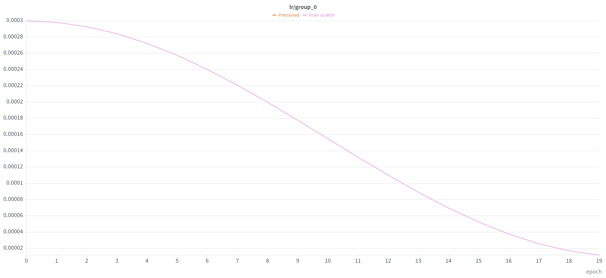
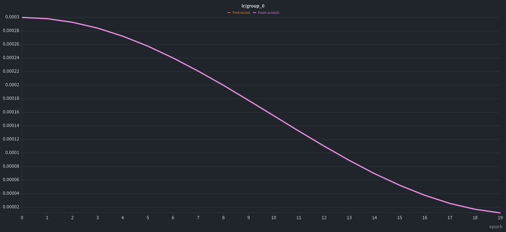
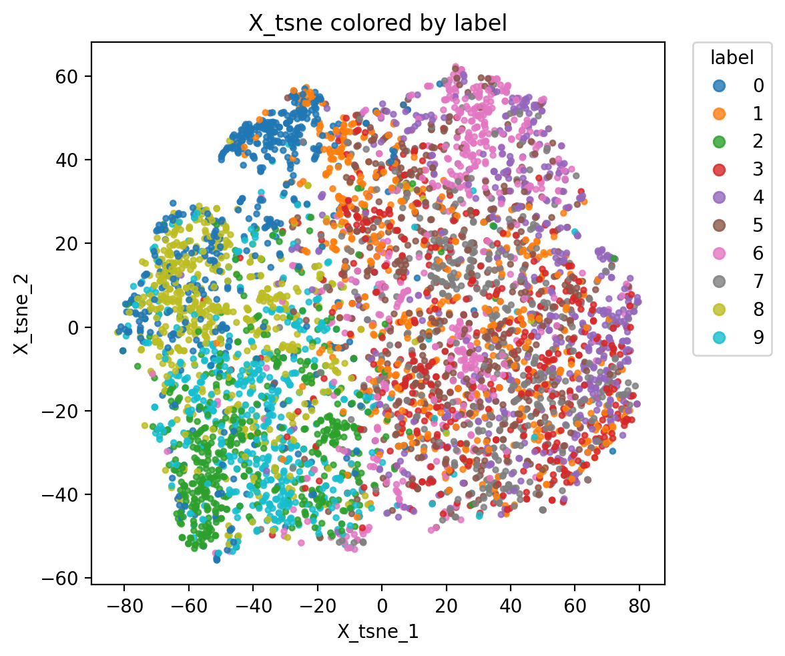
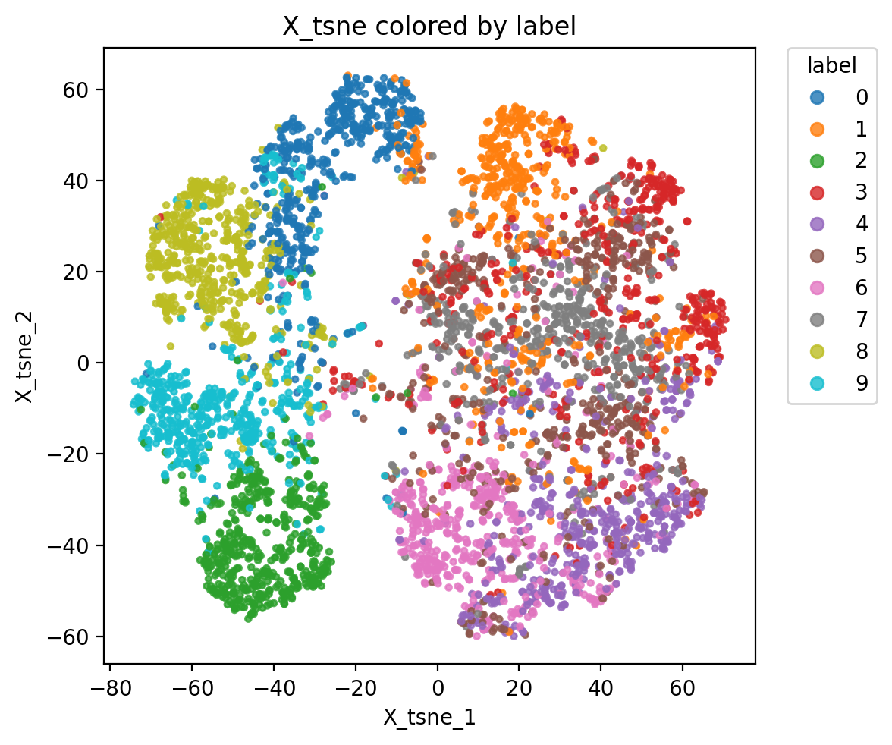

# Learn from multiple views

<strong class="highlight">Under the same contrastive training budget, does an ImageNet-pretrained ResNet learn better representations than one initialized randomly?</strong> One script runs both variants on [STL-10](https://cs.stanford.edu/~acoates/stl10/). The walkthrough shows how the training YAMLs select the two initializations and how both runs share the prediction and evaluation YAMLs.

The composite model uses a shared encoder and projection head. Two independently augmented views of each image form a positive pair, while views of other images in the batch serve as negatives, following the multiview contrastive approach used in [SimCLR](https://arxiv.org/abs/2002.05709).

[:material-script-text-outline: View script](https://github.com/uhlmanngroup/BenchRep/blob/main/src/benchrep/examples/usage/07_learn_from_multiple_views.py) · [View configs](https://github.com/uhlmanngroup/BenchRep/tree/main/src/benchrep/examples/configs/07_learn_from_multiple_views)

## Run the example

???+ warning "Runtime and resource requirements"
    Dataset disk usage is **~5.4 GiB**; deleting the .tar.gz after extraction frees ~2.6 GiB. The intended recipe uses 20 epochs per variant, batch size 128, and limits of 128 training batches and 16 validation batches per epoch. The full unlabeled dataset is loaded into host memory despite those limits.

    To shorten the run, lower the epoch count or batch limits in **both** training YAMLs. To reduce GPU memory use, lower `datamodule.batch_size`, though smaller batches provide fewer contrastive negatives. Prediction has a separate `data.batch_size`.

Install the extras for evaluation and optional model diagrams. If you plan to use Weights & Biases, use `benchrep[scverse,model_graph,wandb]` in the command below.

```bash
python -m pip install "benchrep[scverse,model_graph] @ git+https://github.com/uhlmanngroup/BenchRep.git"
```

Graph export also requires the Graphviz system executable. If a graph dependency is missing, BenchRep logs the reason and skips the export so the workflow can continue. See [Installation](installation.md) for Graphviz setup.

From the directory where you want to keep your data and outputs, choose a logging option and run the example.

=== "CSV (default)"

    ```bash
    python -m benchrep.examples.usage.07_learn_from_multiple_views
    ```

=== "Weights & Biases"

    ```bash
    wandb login
    python -m benchrep.examples.usage.07_learn_from_multiple_views --logger wandb
    ```

See [Follow training](#follow-training) for monitoring and comparing the runs.

The script runs a full workflow chain for each variant and writes a `comparison_<timestamp>.csv` under `outputs/07_learn_from_multiple_views/`. It downloads STL-10 and the pretrained backbone weights as needed.

## Define the comparison

Both variants are trained with [`NTXentContrastiveLoss`][benchrep.architecture.losses.contrastive.NTXentContrastiveLoss]. ***From scratch*** starts with random weights while ***Pretrained*** starts with ImageNet backbone weights. Their architectures, augmentations, optimizer settings, split seed, and training budget are the same.

| File | Purpose                                                                               |
| --- |---------------------------------------------------------------------------------------|
| `training.yaml` | Train the *From scratch* variant                                                      |
| `training_pretrained.yaml` | Train the *Pretrained* variant                                                        |
| `prediction.yaml` | Export the same representation fields from the same labeled images for either variant |
| `evaluation.yaml` | Apply the same analyses, probe settings, and cross-validation splits                  |
| `wandb_logger.yaml` | Optional Weights & Biases configuration                                               |

BenchRep’s [`STL10Dataset`][benchrep.architecture.data.datasets.STL10Dataset] provides access to 96 × 96 RGB images: 100,000 unlabeled images, 5,000 labeled training images, and 8,000 labeled test images. The labeled sets cover 10 classes, though the unlabeled set also includes images from other classes (additional animals and vehicles). Here we learn representations from `unlabeled`, then run cross-validated probes on `train` (`test` split is unused).

??? note "What this comparison establishes"
    The comparison uses a fixed contrastive training budget. The [STL-10](https://cs.stanford.edu/~acoates/stl10/) was drawn from ImageNet and the pretrained backbone also received supervised ImageNet training.

    This example uses five-fold probes on the labeled training split. [STL-10's standard testing protocol](https://cs.stanford.edu/~acoates/stl10/#:~:text=Testing%20Protocol) scores on the designated test split. For stronger conclusions, repeat across training seeds and reserve a final test set if using these results to choose settings.

## Configure the data pipeline

The built-in [`STL10Dataset`][benchrep.architecture.data.datasets.STL10Dataset] supplies the image as `x`. Under `composite_model_declarations.expects`, `x` has the `sample_image` role and the two augmented views have the `positive_image` role. The transform pipelines read `x` and write `view_a` and `view_b` before the model runs. BenchRep clones the source tensor for each pipeline to preserve `x`.

Each pipeline independently applies random cropping and flipping, color jitter and grayscale, and Gaussian blur. It then converts the image to floating point and normalizes it.

??? note "Parameter choices"
    Augmentation settings combine Torchvision defaults with choices for this example. Normalization matches the ImageNet-pretrained weights.

??? tip "Reuse YAML settings with anchors and aliases"
    `&view_steps` names the step list defined for the first pipeline, and `*view_steps` reuses it in the second. Each pipeline draws its own random augmentations from the same settings.

    Likewise, `T_max: &epochs 20` defines the epoch count reused by `max_epochs: *epochs`. Changing the anchored value adjusts both the training duration and cosine schedule. 

The datamodule reserves 12.5% of the unlabeled split for validation. `trainer.limit_train_batches` and `trainer.limit_val_batches` cap the number of batches processed per epoch. Shuffling changes which training samples fall within that limit. `apply_to: [training, validation]` applies the transforms to both subsets. See [Transform pipelines](../concepts/data/transforms.md) and [Splits and dataloaders](../concepts/data/datamodules.md) for configuration details.

??? tip "What about natural pairs of images?"
    For natural pairs, have your dataset return both related images in each sample. Declare their fields as image inputs, route them through the appropriate transform pipelines and assembly steps, and wire the resulting representations to the contrastive loss. Field names are arbitrary, and both inputs can use the `sample_image` role. See [Datasets and sample structure](../concepts/data/datasets.md) and [Composite models](../concepts/models/composite.md).

## Configure the shared model

Under `composite_model_components`, we define one `shared_encoder` and one `shared_projector`.

| Input | Encoder output | Projection-head output |
| --- | --- | --- |
| `view_a` | `embedding_a`: 512 features | `projection_a`: 128 features |
| `view_b` | `embedding_b`: 512 features | `projection_b`: 128 features |

For [`TorchvisionResNet`][benchrep.architecture.encoders.torchvision_resnets.TorchvisionResNet], `weights` selects random initialization (`null`) or pretrained ImageNet weights (`IMAGENET1K_V1`). Both variants use `small_stem: false` to retain the original ResNet input layers and keep the architectures identical.

```yaml
composite_model_components:
  shared_encoder:
    kind: encoder
    name: torchvision_resnet
    params:
      input_shape: [3, 96, 96]
      variant: resnet18
      weights: IMAGENET1K_V1
      small_stem: false
      output_dim: 512
```

Both encoder steps call `shared_encoder`, so the two views pass through **the same encoder weights**. The [full training YAML](https://github.com/uhlmanngroup/BenchRep/blob/main/src/benchrep/examples/configs/07_learn_from_multiple_views/training_pretrained.yaml) uses the same pattern to share `shared_projector` across both embeddings.

```yaml
composite_model_assembly:
  encode_a:
    component: shared_encoder
    inputs:
      x: expects.view_a
    outputs: produces.embedding_a
  encode_b:
    component: shared_encoder
    inputs:
      x: expects.view_b
    outputs: produces.embedding_b
```

BenchRep's ResNet wrapper replaces the classifier with a linear output projection. Here, we add a separate [MLP projection head][benchrep.architecture.heads.mlp.MLPHead]. Both projections are initialized randomly. **All parameters are trained in both variants.**

### Wire the contrastive loss

We select the registered [`NTXentContrastiveLoss`][benchrep.architecture.losses.contrastive.NTXentContrastiveLoss] and use `composite_wiring` to connect its named arguments to the projection outputs:

```yaml
losses:
  contrastive:
    - name: nt_xent
      weight: 1.0
      params:
        temperature: 0.2
      composite_wiring:
        view_a: produces.projection_a
        view_b: produces.projection_b
```

The loss uses `projection_a` and `projection_b`, while prediction exports `embedding_a` and `embedding_b` for evaluation. See [Composite models](../concepts/models/composite.md) and [Losses and objectives](../concepts/models/losses.md) for component assembly and loss wiring.

### Inspect the architecture

Use the [model specification graph](../concepts/training/inspection.md#inspect-model-structure) to inspect how both views share components and connect to the loss. 

<figure>
  <a href="../assets/guides/learn-from-multiple-views/model-specification.svg">
    
  </a>
  <figcaption>Steps with matching badges reuse the same component and weights. <code>@A</code> marks the shared encoder and <code>@B</code> marks the shared projection head. The loss receives the projection vectors, and evaluation uses the encoder embeddings.</figcaption>
</figure>

Both training configurations enable Torchview through `inspection.torchview.enabled`, exporting a graph of operations and tensor shapes inside the components after training. See [Model structure inspection](../concepts/training/inspection.md#inspect-model-structure) for details.

[:material-file-image-outline: View the full Torchview graph ↗](../assets/guides/learn-from-multiple-views/torchview-model-graph.svg){ target="_blank" rel="noopener" }

## Follow training

Both training YAMLs configure AdamW with a cosine learning-rate schedule under `optimizer.lr_scheduler`. The `checkpointing` section selects the checkpoint with the lowest total weighted validation loss. See [Schedule and monitor training](schedule-and-monitor-training.md) for scheduling and gradient inspection. With W&B enabled, the script logs ***From scratch*** and ***Pretrained*** as separate runs in the same timestamped group.

The training and validation loss histories are logged as `losses/train/total_weighted_loss` and `losses/val/total_weighted_loss`; `lr/group_0` records the learning rate.

<figure>
  <table>
    <thead>
      <tr>
        <th>Loss</th>
        <th>Learning rate</th>
      </tr>
    </thead>
    <tbody>
      <tr>
        <td>
          <a class="br-image-light" href="../assets/guides/learn-from-multiple-views/training-comparison-loss-light.png">
            
          </a>
          <a class="br-image-dark" href="../assets/guides/learn-from-multiple-views/training-comparison-loss-dark.png">
            
          </a>
        </td>
        <td>
          <a class="br-image-light" href="../assets/guides/learn-from-multiple-views/training-comparison-lr-light.png">
            
          </a>
          <a class="br-image-dark" href="../assets/guides/learn-from-multiple-views/training-comparison-lr-dark.png">
            
          </a>
        </td>
      </tr>
    </tbody>
  </table>
  <figcaption>Validation loss histories (left) and the shared cosine learning-rate schedule (right), displayed in W&B.</figcaption>
</figure>

??? tip "Use another logger"
    The script's CLI accepts CSV and W&B. Other built-in loggers, including TensorBoard and MLflow, can be selected directly in the training YAMLs; custom Lightning-compatible loggers can also be registered. See [Choose a logger](schedule-and-monitor-training.md#choose-a-logger).

## Export comparable embeddings

The script passes each training manifest to [`predict_composite()`][benchrep.predict_composite] through [`PredictionOverrides`][benchrep.PredictionOverrides]. Both variants use the same prediction YAML to load their best checkpoint and process STL-10's labeled `train` split.

The prediction YAML gives `view_a` fixed preprocessing and keeps random augmentations for `view_b`. Composite AnnData export requires an explicit `primary_key`. This example sets it to `embedding_a`, so evaluation uses the fixed-view representation in `AnnData.X`. `embedding_b` goes into `AnnData.obsm`, labels into `AnnData.obs["label"]`, and sample identifiers into `AnnData.obs_names`. See [Selecting prediction exports](../concepts/prediction/exports.md) for configuration details.

```yaml
exports:
  anndata:
    enabled: true
    mode: custom
    keys:
      - embedding_a
      - embedding_b
    primary_key: embedding_a
  reconstructions:
    enabled: false
```

??? question "Why use `del` and `gc.collect()`?"
    Workflow results retain runtime objects such as models and datamodules. The script keeps their manifest paths, deletes the results, and calls `gc.collect()` to release unused objects before starting another workflow in the same process.

## Evaluate and compare

The script passes each prediction manifest to [`evaluate()`][benchrep.evaluate] through [`EvaluationOverrides`][benchrep.EvaluationOverrides]. A shared evaluation YAML applies the same analyses and probe splits to both variants:

| Analysis | Configuration used here |
| --- | --- |
| [Predictability](../concepts/evaluation/predictability.md) | Five-fold balanced accuracy for a dummy baseline, logistic regression, cosine-distance k-NN, and a random forest |
| [Clustering](../concepts/evaluation/reductions-clustering.md) | K-means and Leiden, with internal metrics and agreement with class labels |
| [Embedding metrics](../concepts/evaluation/metrics.md) | Feature standard deviations and quantiles |
| [Figure exports](../concepts/evaluation/figures.md) | PCA, UMAP, and t-SNE projections colored by class label, saved as PNG and SVG |

Probes evaluate `AnnData.X` and are configured under `metrics.predictability.targets.label`. The `use_rep` setting selects inputs for other analyses: here, t-SNE uses `X_pca`, while UMAP and Leiden use `X`.

Each evaluation run saves its plots under `figures/anndata/`. The t-SNE plots below use the [STL-10 class order](https://cs.stanford.edu/~acoates/stl10/#:~:text=10%20classes%3A). Labels 0–9 correspond to airplane, bird, car, cat, deer, dog, horse, monkey, ship, and truck.

<figure>
  <table>
    <thead>
      <tr>
        <th>From scratch</th>
        <th>Pretrained</th>
      </tr>
    </thead>
    <tbody>
      <tr>
        <td>
          <a href="../assets/guides/learn-from-multiple-views/tsne-from-scratch.png">
            
          </a>
        </td>
        <td>
          <a href="../assets/guides/learn-from-multiple-views/tsne-pretrained.png">
            
          </a>
        </td>
      </tr>
    </tbody>
  </table>
  <figcaption>Each point represents one labeled STL-10 training image, with matching class colors across panels. Each t-SNE projection is fitted independently.</figcaption>
</figure>

See [Evaluate external outputs](standalone-evaluation.md) for a broader demonstration of BenchRep's evaluation features.

### Compare the scores

The script uses [`get_metric()`][benchrep.workflows.evaluate.EvaluationWorkflowResult.get_metric] to retrieve each probe's mean balanced accuracy and fold standard deviation, then writes them alongside the run manifest paths to the comparison CSV. See [Inspect the result](first-workflow-chain.md#inspect-the-result) for metric retrieval.

The table shows balanced accuracy from one run (mean ± standard deviation across five folds). The comparison CSV also includes the dummy baseline.

| Probe | *From scratch* | *Pretrained*    |
| --- |----------------|-----------------|
| Linear | 58.1 ± 2.5%    | **81.4 ± 1.1%** |
| k-NN | 53.5 ± 0.6%    | **78.3 ± 1.7%** |
| Random forest | 57.1 ± 0.9%    | **80.0 ± 1.8%** |

In this run, the ImageNet-initialized model had higher mean balanced accuracy for all three probes shown.
