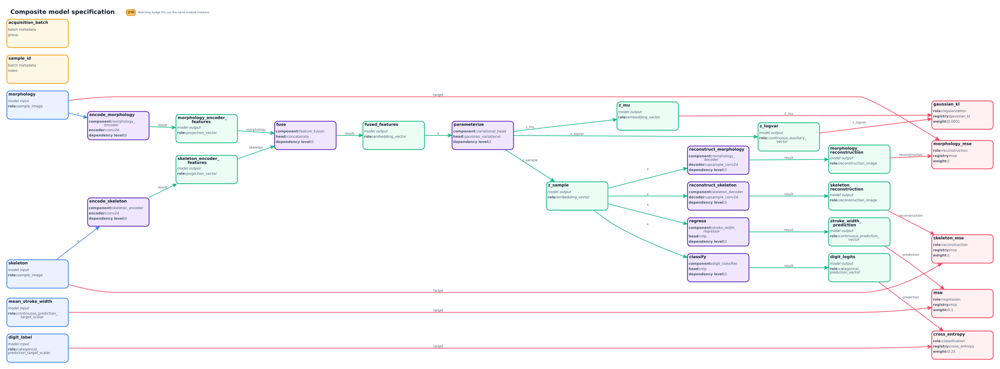
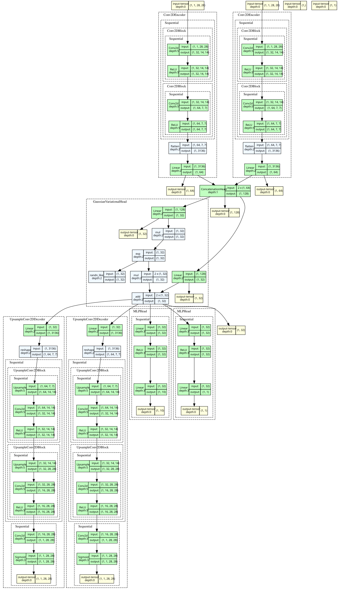
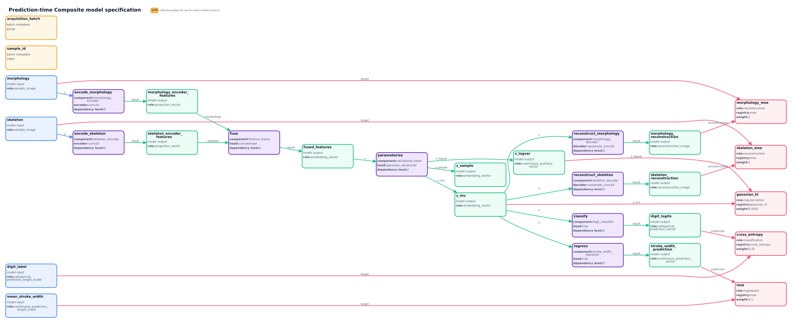
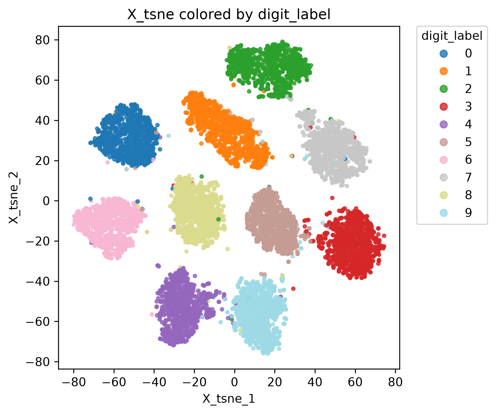
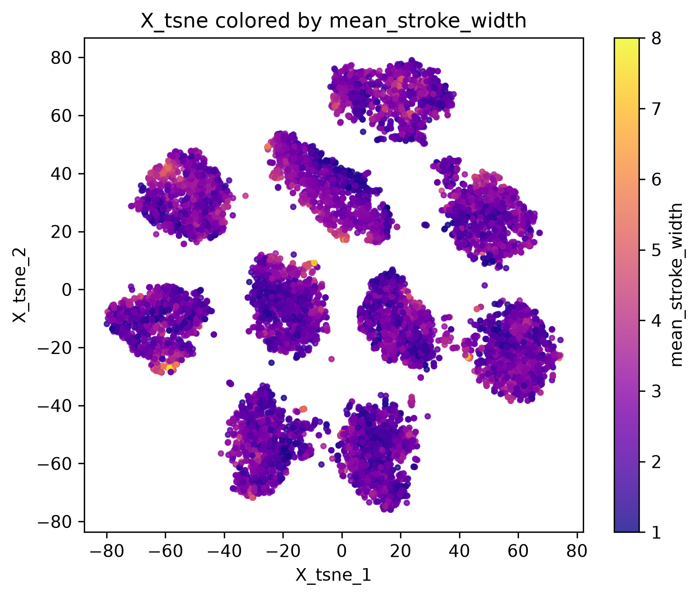
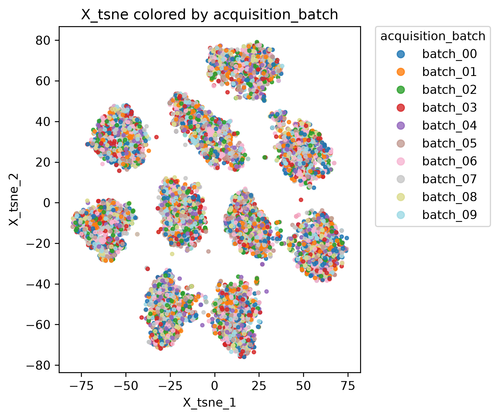
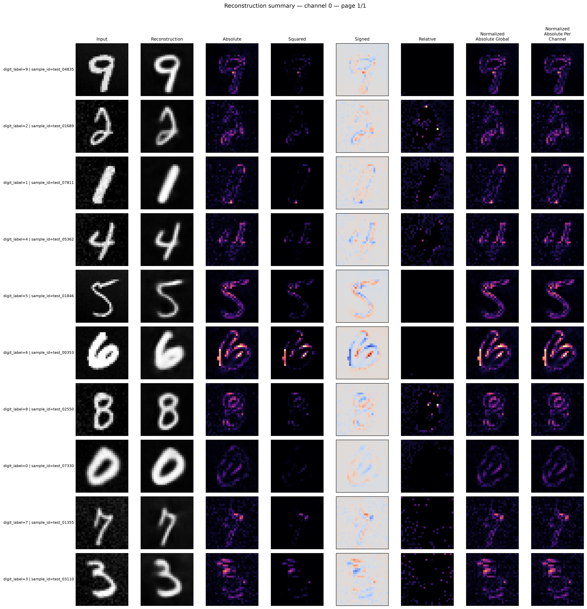

# Build a composite model

<strong class="highlight">How can I combine multiple inputs and objectives in one config-built model?</strong> Here we build a dual-input, multitask VAE in the Composite family. An enriched [MNIST](http://yann.lecun.com/exdb/mnist/) dataset supplies two image representations of each digit. The model combines them to reconstruct both images and predict digit identity and stroke width.

The main script defines and registers the custom `EnrichedMNISTDataset` and a small fusion component, then calls [`train_composite()`][benchrep.train_composite], [`predict_composite()`][benchrep.predict_composite], and [`evaluate()`][benchrep.evaluate]. The walkthrough uses YAML to configure the model's connections and objectives. A [second script](#configure-the-same-model-interactively) uses those YAMLs as starting points in the browser wizard.

[:material-script-text-outline: View script](https://github.com/uhlmanngroup/BenchRep/blob/main/src/benchrep/examples/usage/08A_dual_input_multitask_composite_vae_yaml.py) · [View configs](https://github.com/uhlmanngroup/BenchRep/tree/main/src/benchrep/examples/configs/08_dual_input_multitask_composite_vae_pipeline)

## Run the example

Install the extras used for dataset preparation, evaluation, and model diagrams:

```bash
python -m pip install "benchrep[artifact_generation,scverse,xgboost,model_graph] @ git+https://github.com/uhlmanngroup/BenchRep.git"
```

!!! warning "XGBoost on macOS"
    Omit the `xgboost` extra and remove `xgboost` from `metrics.predictability.targets.mean_stroke_width.selected` before evaluation. You can make that change in the [evaluation wizard](#configure-the-same-model-interactively). See [XGBoost on macOS](../known-issues.md#xgboost-on-macos).

Graph export also requires the Graphviz system executable. If a graph dependency is missing, BenchRep logs the reason and skips the export so the workflow can continue. See [Installation](installation.md) for Graphviz setup.

From the directory where you want to keep your data and outputs, run:

```bash
python -m benchrep.examples.usage.08A_dual_input_multitask_composite_vae_yaml
```

The script downloads MNIST if needed and prints each workflow's output directory and manifest path.

???+ warning "Runtime and resource requirements"
    The dataset prepares morphology and skeleton images for the full selected MNIST split. Training runs for 10 epochs at batch size 128, followed by prediction and an extensive evaluation with several cross-validated probes.

    Lower `trainer.max_epochs` or add training and validation batch limits to shorten training. Lower `datamodule.batch_size` for GPU memory, or select fewer probes under `metrics.predictability.targets` to shorten evaluation. Batch limits do not reduce dataset preparation.

## Define the inputs and outputs

The custom dataset enriches [MNIST](http://yann.lecun.com/exdb/mnist/) with a skeleton image, an estimated stroke width, and simulated acquisition effects. Each sample contains the following fields.

| Field | Use in this example |
| --- | --- |
| `morphology`, `skeleton` | Two single-channel image inputs, each with shape `(1, 28, 28)` |
| `digit_label` | Classification target |
| `mean_stroke_width` | Regression target |
| `sample_id`, `acquisition_batch` | Sample identifier and acquisition annotation |

The datamodule holds out 10% of the training split for validation. Prediction uses the test split. See [Register external components](register-components.md) for dataset registration.

### Declare the batch fields

In `composite_model_declarations`, you choose the field names and assign roles from the set BenchRep defines for each section. `expects` lists the batch fields that model components or losses can use. The digit label and stroke width go here because the dataset supplies them as training targets. `batch_metadata` lists fields retained in prediction exports as sample identifiers (`index`) or annotations (`group`). See [Declared roles](../concepts/models/composite.md#declared-roles).

```yaml
composite_model_declarations:
  expects:
    morphology: sample_image
    skeleton: sample_image
    digit_label: categorical_prediction_target_scalar
    mean_stroke_width: continuous_prediction_target_scalar
  batch_metadata:
    sample_id: index
    acquisition_batch: group
```

### Route the image transforms

A transform pipeline reads a sample field, applies its configured steps, and writes the result to an output field. Here, two pipelines convert the images to `float32` in `[0, 1]` for training and validation.

For composite models, BenchRep infers a pipeline’s `input` only when exactly one field has the `sample_image` role. Here, `morphology` and `skeleton` both have that role, so each pipeline sets `input` explicitly. An omitted `output` defaults to `input`, so each pipeline writes back to the field it read.

```yaml
transform_pipelines:
  - input: morphology
    steps:
      - name: to_dtype
        apply_to: [training, validation]
        params:
          dtype: float32
          scale: true
```

The second pipeline uses the same settings with `input: skeleton`. See [Transform pipelines](../concepts/data/transforms.md#route-fields-through-pipelines) for the routing rules.

### Declare what the model produces

Return to `composite_model_declarations` and add `produces` alongside `expects` and `batch_metadata`. Declare the intermediate values passed between components, such as encoder features and VAE latents, as well as the final reconstructions and predictions. The next section uses these names to wire the components together.

```yaml
composite_model_declarations:  
  produces:
    morphology_encoder_features: projection_vector
    skeleton_encoder_features: projection_vector
    fused_features: embedding_vector

    z_sample: embedding_vector
    z_mu: embedding_vector
    z_logvar: continuous_auxiliary_vector

    morphology_reconstruction: reconstruction_image
    skeleton_reconstruction: reconstruction_image

    digit_logits: categorical_prediction_vector
    stroke_width_prediction: continuous_prediction_vector
```

## Select components and connect them

`composite_model_components` selects registered implementations and sets their constructor parameters. `composite_model_assembly` specifies how to call those components and where their inputs and outputs go.

| Component | Input → output |
| --- | --- |
| Two independent convolutional encoders | Each image → 64 features |
| Custom concatenation head | Both feature vectors → 128 fused features |
| Gaussian variational head | Fused features → 32-dimensional posterior mean, log variance, and sampled latent |
| Two decoders | Sampled latent → morphology and skeleton reconstructions |
| Classification and regression heads | Sampled latent → 10 digit logits and one stroke-width prediction |

The encoders use the same configuration but have different component identifiers, so they have **separate weights**. Reusing one identifier across calls would share weights, as in [Learn from multiple views](learn-from-multiple-views.md).

The snippets below show how to register and wire the fusion head, then how to wire the variational head. The [full training YAML](https://github.com/uhlmanngroup/BenchRep/blob/main/src/benchrep/examples/configs/08_dual_input_multitask_composite_vae_pipeline/training.yaml) lists all the components and assembly steps.

The fusion head is a PyTorch module that concatenates the two feature vectors along the feature dimension.

```python
import torch
from torch import nn


class ConcatenationHead(nn.Module):
    def forward(self, *, morphology, skeleton):
        return torch.cat((morphology, skeleton), dim=1)
```

The script registers `ConcatenationHead` as `concatenate` in `HEADS`. The [`ArchitectureComponent`][benchrep.architecture.composite_model_component_contracts.ArchitectureComponent] declares the two vector arguments to `forward()` and its vector result. See [Architecture component contracts](../concepts/models/component-contracts.md).

```python
from benchrep.architecture.composite_model_component_contracts import (
    ArchitectureComponent,
    ComponentPort,
    ComponentTensorResult,
)
from benchrep.assembly.registries import HEADS

HEADS.register(
    "concatenate",
    ArchitectureComponent(
        component=ConcatenationHead,
        runtime_inputs=(
            ComponentPort(name="morphology", supported_structures=("vector",)),
            ComponentPort(name="skeleton", supported_structures=("vector",)),
        ),
        runtime_result=ComponentTensorResult(supported_structures=("vector",)),
    ),
)
```

In the YAML, `name: concatenate` selects the registered head, `feature_fusion` identifies the component instance, and `fuse` names the assembly step that calls it.

```yaml
composite_model_components:
  feature_fusion:
    kind: head
    name: concatenate
    params: {}

composite_model_assembly:
  fuse:
    component: feature_fusion
    inputs:
      morphology: produces.morphology_encoder_features
      skeleton: produces.skeleton_encoder_features
    outputs: produces.fused_features
```

Under `inputs`, the keys `morphology` and `skeleton` are the head's `forward()` arguments. The `produces.*` references pass in features computed by the encoder steps. Those steps read the images from the batch through `expects.morphology` and `expects.skeleton`. BenchRep uses these dependencies to run the encoders before fusion.

The full YAML declares the built-in [`GaussianVariationalHead`][benchrep.architecture.heads.variational.GaussianVariationalHead] as `variational_head`. In the same `composite_model_assembly` block, the `parameterize` step passes it the fused features and maps each key it returns to a declared value.

```yaml
composite_model_assembly:
  parameterize:
    component: variational_head
    inputs:
      x: produces.fused_features
    outputs:
      z_sample: produces.z_sample
      z_mu: produces.z_mu
      z_logvar: produces.z_logvar
```

The remaining steps use the same wiring pattern. During training, both decoders and both prediction heads read `produces.z_sample`. The variational head's `in_features: 128` matches the fusion output, and its `latent_dim: 32` matches the downstream components' `input_dim: 32`.

See [Composite implementation](../concepts/models/composite.md#implementation) for how BenchRep turns the configuration into an execution plan.

## Wire the objectives

Each loss in this example uses `composite_wiring` to select its inputs. The snippet shows the morphology reconstruction term.

```yaml
losses:
  reconstruction:
    - name: mse
      id: morphology
      weight: 1.0
      params:
        reduction: mean
      composite_wiring:
        reconstruction: produces.morphology_reconstruction
        target: expects.morphology
```

The full configuration combines five terms:

| Objective | Values compared | Weight |
| --- | --- | --- |
| Morphology reconstruction | Reconstructed and input morphology | `1.0` |
| Skeleton reconstruction | Reconstructed and input skeleton | `1.0` |
| Gaussian KL divergence | Posterior mean and log variance, relative to the standard-normal prior | `0.0001` |
| Cross-entropy | Digit logits and digit labels | `0.25` |
| Regression MSE | Predicted and measured stroke width | `0.1` |

The two reconstruction terms select the same registered loss, with separate `id` values to distinguish them in logs and inspection settings. An `id` is optional when the registered loss names are unique within a role, as they are for the other terms in this example. BenchRep sums the weighted terms for training. Wiring the losses is what makes their targets contribute to learning; declarations alone do not create objectives.

See [Losses and objectives](../concepts/models/losses.md) for contracts and [Schedule and monitor training](schedule-and-monitor-training.md) for inspecting and adjusting their contributions.

## Inspect the model and change prediction behavior

BenchRep automatically exports a specification graph for Composite training and prediction runs when the graph dependencies are available. It shows how the components and losses are wired. The training YAML also enables Torchview through `inspection.torchview.enabled` to show operations and tensor shapes inside the model. The training result exposes the paths as `training_result.composite_model_spec_graph_path` and `training_result.torchview_graph_path`. See [Model structure inspection](../concepts/training/inspection.md#inspect-model-structure).

<figure>
  <a href="../assets/guides/multitask-composite/training-model-specification.svg">
    
  </a>
  <figcaption>During training, the sampled latent <code>z_sample</code> feeds both decoders and both prediction heads.</figcaption>
</figure>

<figure style="width: 480px; max-width: 100%; margin-inline: auto;">
  <a href="../assets/guides/multitask-composite/torchview-model-graph.svg">
    
  </a>
  <figcaption>Click to inspect the operations and tensor shapes recorded during the model’s forward pass.</figcaption>
</figure>

In this example, prediction loads the best checkpoint but also changes the wiring such that both decoders and both prediction heads are fed the posterior mean instead of a sampled vector. This is the override for morphology reconstruction:

```yaml
inference:
  composite_model_assembly_input_overrides:
    reconstruct_morphology:
      inputs:
        z: produces.z_mu
```

The prediction YAML also routes `produces.z_mu` to the skeleton decoder’s `z` input and to the `x` input of both prediction heads. All four steps retain their components and checkpoint weights. See [Prediction behavior](../concepts/models/composite.md#prediction-behavior) for the override constraints.

!!! note "Prediction still uses the declared batch contract"
    The dataset supplies both images and both targets during prediction. BenchRep runs the full assembly before selecting which results to export. The specification graph still shows the inherited loss wiring, even though prediction does not compute those losses.

Open `prediction_result.composite_model_spec_graph_path` to check the four updated connections.

<figure>
  <a href="../assets/guides/multitask-composite/prediction-model-specification.svg">
    
  </a>
  <figcaption>The prediction overrides route <code>z_mu</code> to the four steps that read <code>z_sample</code> during training.</figcaption>
</figure>

## Export and evaluate the results

Composite and YOYO models require an explicit `exports.anndata.primary_key` when AnnData export is enabled. Canonical AE and VAE models default to `embedding`.

This example sets `primary_key: z_mu`, so the posterior means go into `AnnData.X`. With `mode: all`, AnnData export selects every non-image output declared under `produces`. The other vector outputs go into `AnnData.obsm`. The scalar targets and `acquisition_batch` become columns in `AnnData.obs`, and `sample_id` supplies the observation index. See [Available keys by model family](../concepts/prediction/exports.md#available-keys-depend-on-the-model).

### Inspect the embeddings

The evaluation YAML runs reductions, clustering, and predictability probes on the exported posterior means. The embedding plots are saved under `figures/anndata/` in the evaluation output directory. See [Evaluate external outputs](standalone-evaluation.md) for more on configuring these analyses.

<figure>
  <table style="width: 100%; table-layout: fixed;">
    <thead>
      <tr>
        <th scope="col">Digit label</th>
        <th scope="col">Mean stroke width</th>
        <th scope="col">Acquisition batch</th>
      </tr>
    </thead>
    <tbody>
      <tr>
        <td>
          <a href="../assets/guides/multitask-composite/enriched-mnist-tsne-digit-label.png">
            
          </a>
        </td>
        <td>
          <a href="../assets/guides/multitask-composite/enriched-mnist-tsne-stroke-width.png">
            
          </a>
        </td>
        <td>
          <a href="../assets/guides/multitask-composite/enriched-mnist-tsne-acquisition-batch.png">
            
          </a>
        </td>
      </tr>
    </tbody>
  </table>
  <figcaption>All three panels show the same t-SNE projection of the test-set posterior means (<code>z_mu</code>). Click a panel to view it at full size.</figcaption>
</figure>

??? note "What can linear probes predict from the embeddings?"
    Scores come from five-fold cross-validation on the full `z_mu` vectors. The digit and stroke-width probes hold out whole acquisition batches in each fold. The acquisition-batch logistic regression probe uses [nested cross-validation](../concepts/evaluation/predictability.md#tune-inside-the-training-folds) to tune regularization with three inner folds.

    | Target | Metric | Linear probe | Mean ± SD | Dummy mean |
    | --- | --- | --- | ---: | ---: |
    | Digit label | Balanced accuracy | Logistic regression | 0.983 ± 0.004 | 0.100 |
    | Mean stroke width | R² | Ridge regression | 0.901 ± 0.003 | −0.001 |
    | Acquisition batch | Balanced accuracy | Logistic regression | 0.601 ± 0.009 | 0.100 |
    
    The full evaluation metrics, including scores for all probes and each fold, are saved in `records/metrics/metrics.json` in the evaluation run directory.

    How do these scores compare with the patterns you see in t-SNE? What might a nonlinear probe pick up about acquisition batch?

### Inspect the reconstructions

Prediction saves both reconstruction pairs, configured to export 32 examples per pair stratified by digit label. Each evaluation run reads one bundle. The supplied YAML sets `source.reconstruction_pair_id: reconstruction_bundle_01` for morphology, shown below. Run evaluation with `reconstruction_bundle_02` to inspect the skeleton reconstructions. The prediction manifest lists the input and output names for both bundles under `exports.reconstructions.pairs`.

<figure style="width: 560px; max-width: 100%; margin-inline: auto;">
  <a href="../assets/guides/multitask-composite/enriched-mnist-reconstructions.png">
    
  </a>
  <figcaption>Each row shows a morphology input, its reconstruction, and the corresponding error maps. Click to view the full panel.</figcaption>
</figure>

## Configure the same model interactively

The wizard example registers the same components and opens each workflow's wizard with the existing YAML as its starting point.

[:material-script-text-outline: View script](https://github.com/uhlmanngroup/BenchRep/blob/main/src/benchrep/examples/usage/08B_dual_input_multitask_composite_vae_wizard.py) · [View configs](https://github.com/uhlmanngroup/BenchRep/tree/main/src/benchrep/examples/configs/08_dual_input_multitask_composite_vae_pipeline)

Install the `gui` extra, then run:

```bash
python -m benchrep.examples.usage.08B_dual_input_multitask_composite_vae_wizard
```

Review the model specification before training, edit settings, and save to continue. The script forwards both the wizard's config and its returned overrides to the workflow. See [Configure workflows](configure-workflows/index.md#browser-wizard) for the editor and review process.
