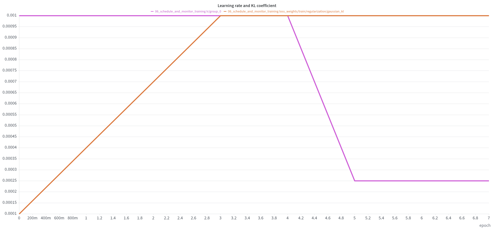
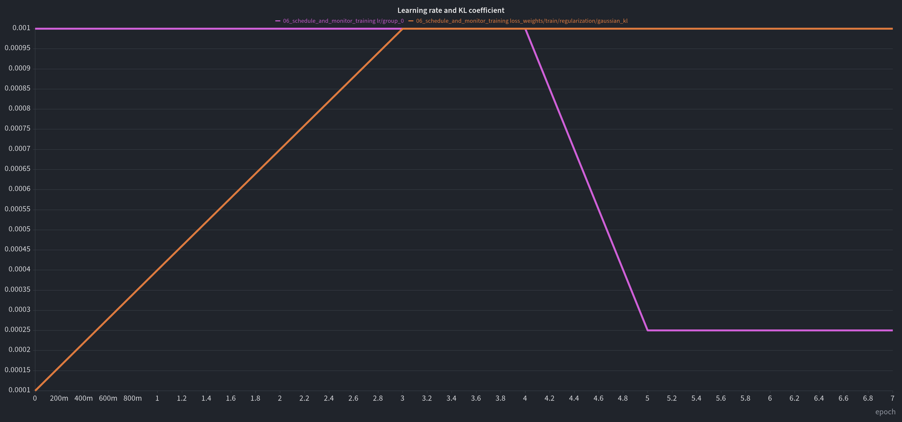
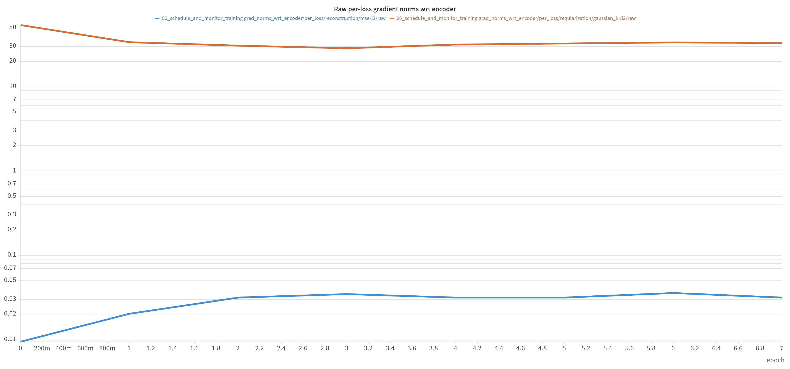
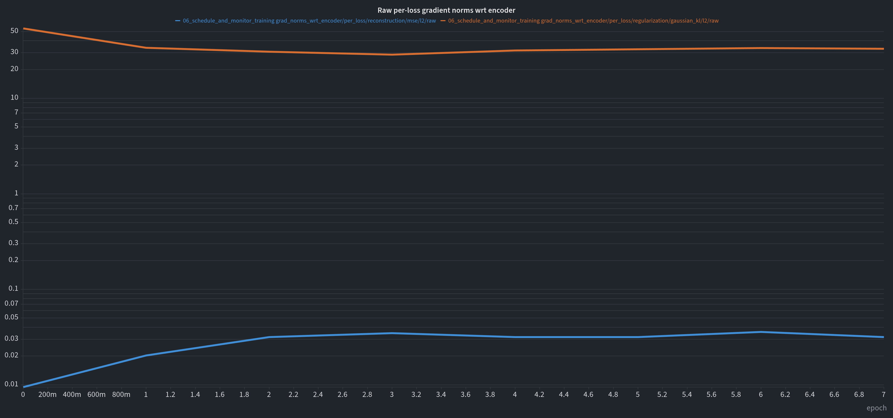
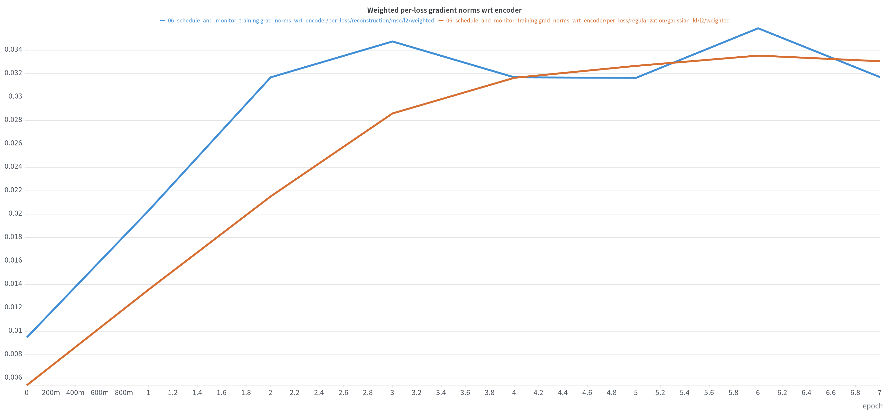
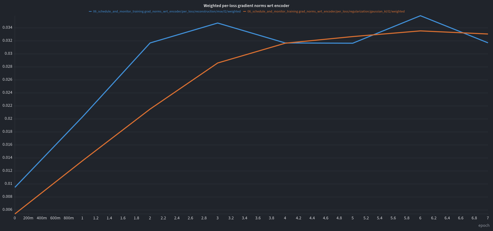
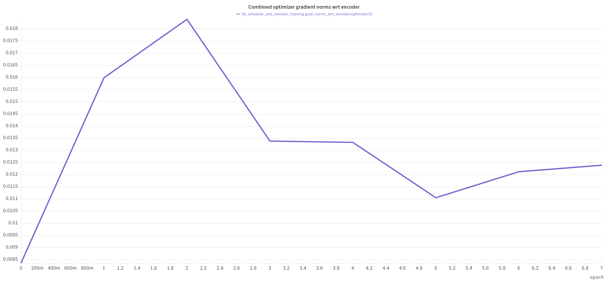
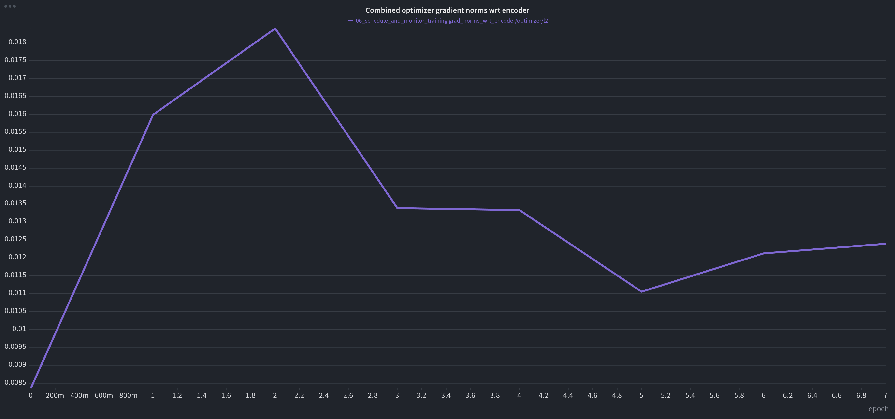

# Schedule and monitor training

<strong class="highlight">How can I diagnose training problems, balance objectives, and adjust the learning process over time?</strong> BenchRep supports inspecting gradient norms, weighting individual loss terms, and scheduling both loss weights and learning rates.

We use a single training script to fit a small VAE on [MNIST](http://yann.lecun.com/exdb/mnist/). The snippets show how to track the gradient contributions from reconstruction and regularization, gradually increase the KL-divergence weight, and lower the learning rate later in training. The script logs to CSV by default and can load an optional Weights & Biases logger config.

[:material-script-text-outline: View script](https://github.com/uhlmanngroup/BenchRep/blob/main/src/benchrep/examples/usage/06_schedule_and_monitor_training.py){ .md-button }
[:material-file-cog-outline: View configs](https://github.com/uhlmanngroup/BenchRep/tree/main/src/benchrep/examples/configs/06_schedule_and_monitor_training){ .md-button }
{: .br-tutorial-resources }

## Run the example

CSV logging uses the core installation. To use Weights & Biases, install the `wandb` extra if needed.

```bash
python -m pip install "benchrep[wandb] @ git+https://github.com/uhlmanngroup/BenchRep.git"
```

From the directory where you want to keep your data and outputs, choose a logging option and run the example.

=== "CSV (default)"

    Save training metrics locally as CSV files.

    ```bash
    python -m benchrep.examples.usage.06_schedule_and_monitor_training
    ```

=== "Weights & Biases"

    Follow training live in your W&B workspace.

    ```bash
    wandb login
    python -m benchrep.examples.usage.06_schedule_and_monitor_training --logger wandb
    ```

See [Choose a logger](#choose-a-logger) for logger configuration and other backends.

The script downloads MNIST if needed and trains an MLP VAE with a 16-dimensional latent space for up to 8 epochs. It holds out 10% of the training split for validation and uses a batch size of 128.

The script writes outputs under `outputs/06_schedule_and_monitor_training/` and prints the training manifest path. With CSV logging, it also prints the `metrics.csv` path and, on completion, a per-epoch summary. For a full training → prediction → evaluation chain, see [Run your first workflow chain](first-workflow-chain.md).

## Schedule the objective and the optimizer

The VAE uses [MSE][benchrep.architecture.losses.reconstruction.MSEReconstructionLoss] for reconstruction and [Gaussian KL divergence][benchrep.architecture.losses.regularization.GaussianKLDivergenceLoss] for regularization. We gradually increase the KL weight during training.

| Control | What changes here | Purpose |
| --- | --- | --- |
| Loss-weight schedule | KL coefficient increases from `0.0001` to `0.001` over epoch indices 0–3 | Change the relative contribution of regularization |
| Learning-rate schedule | Adam's learning rate drops from `0.001` to `0.00025` at epoch index 5 | Change the optimizer's step-size setting |

### Increase the KL contribution

The loss term declares a base weight and a schedule that multiplies it:

```yaml
losses:
  reconstruction:
    - name: mse
      weight: 1.0
      params:
        reduction: mean
  regularization:
    - name: gaussian_kl
      weight: 0.001
      params:
        reduction: mean
      weight_schedule:
        name: linear
        interval: epoch
        params:
          start: 0
          end: 3
          start_factor: 0.1
          end_factor: 1.0
```

The effective coefficient is `weight × schedule factor`. With this [linear schedule][benchrep.architecture.losses.weight_schedules.LinearSchedule], the KL weights at epoch indices 0, 1, 2, and 3 are `0.0001`, `0.0004`, `0.0007`, and `0.001`; the last value is retained afterward. Reconstruction keeps weight `1.0`.

These weights are not normalized. Their useful scale depends on the loss definitions and reductions, so this is an illustrative recipe rather than a general recommendation for VAEs. See [Loss-weight schedules](../concepts/models/loss-weight-schedules.md) for other schedules, step-based timing, and custom implementations.

### Reduce the learning rate later

Once the KL coefficient has settled, a multi-step scheduler reduces Adam's learning rate:

```yaml
optimizer:
  name: adam
  params:
    lr: 0.001
  lr_scheduler:
    name: multi_step
    interval: epoch
    params:
      milestones: [5]
      gamma: 0.25
```

The registered scheduler wraps PyTorch's [`MultiStepLR`](https://docs.pytorch.org/docs/2.15/generated/torch.optim.lr_scheduler.MultiStepLR.html). Lightning advances it at epoch boundaries, changing the learning rate independently of the loss weights. See [Training and optimization](../concepts/training/optimization.md#schedule-the-learning-rate) and the [scheduler catalogue](../reference/components.md#catalogue-lr_scheduler).

<figure style="width: 640px; max-width: 100%; margin-inline: auto;">
  <a class="br-image-light" href="../assets/guides/schedule-and-monitor-training/learning-rate-and-kl-coefficient-light.png">
    
  </a>
  <a class="br-image-dark" href="../assets/guides/schedule-and-monitor-training/learning-rate-and-kl-coefficient-dark.png">
    
  </a>
  <figcaption>W&B plot of the KL coefficient and learning rate by epoch index. Both settings are constant within each epoch.</figcaption>
</figure>

## Measure each objective's effect on the encoder

Monitor the combined encoder gradient norm for spikes or persistently small gradients. Compare the raw and weighted per-loss norms to see whether one objective dominates and how much the loss weights contribute to that imbalance

```yaml
inspection:
  gradient_norms:
    - kind: per_loss
      target: encoder
      losses: [reconstruction.mse, regularization.gaussian_kl]
      norm_type: l2
      every_n_batches: 1
    - kind: optimizer_gradients
      target: encoder
      norm_type: l2
      every_n_optimizer_steps: 1
```

| Setting | Measurement | What it measures |
| --- | --- | --- |
| `per_loss` | Raw | Each loss term’s encoder gradient norm before weighting |
| `per_loss` | Weighted | Each loss term’s encoder gradient norm after weighting |
| `optimizer_gradients` | Combined | The combined encoder gradient norm before clipping and the optimizer step |

The combined norm is generally **not the sum of the individual norms**: gradients can reinforce or oppose each other. Nor is it the size of Adam's eventual parameter update, which also depends on its learning rate and running statistics. Per-loss norms help identify a dominant contribution, but cannot establish whether objectives agree in direction.

<figure>
  <table>
    <thead>
      <tr>
        <th>Raw per-loss</th>
        <th>Weighted per-loss</th>
        <th>Combined optimizer</th>
      </tr>
    </thead>
    <tbody>
      <tr>
        <td>
          <a class="br-image-light" href="../assets/guides/schedule-and-monitor-training/raw-per-loss-grad-norm-comparison-light.png">
            
          </a>
          <a class="br-image-dark" href="../assets/guides/schedule-and-monitor-training/raw-per-loss-grad-norm-comparison-dark.png">
            
          </a>
        </td>
        <td>
          <a class="br-image-light" href="../assets/guides/schedule-and-monitor-training/weighted-per-loss-grad-norm-comparison-light.png">
            
          </a>
          <a class="br-image-dark" href="../assets/guides/schedule-and-monitor-training/weighted-per-loss-grad-norm-comparison-dark.png">
            
          </a>
        </td>
        <td>
          <a class="br-image-light" href="../assets/guides/schedule-and-monitor-training/combined-optimizer-grad-norm-comparison-light.png">
            
          </a>
          <a class="br-image-dark" href="../assets/guides/schedule-and-monitor-training/combined-optimizer-grad-norm-comparison-dark.png">
            
          </a>
        </td>
      </tr>
    </tbody>
  </table>
  <figcaption>These W&B plots show encoder gradient norms by epoch index. The example logs them at every training step. The raw per-loss panel uses a logarithmic y-axis. Click a plot to view it at full size.</figcaption>
</figure>

??? tip "Reduce inspection overhead"
    Per-loss inspection adds differentiation work and can increase runtime and memory use. For longer runs, increase `every_n_batches` and `every_n_optimizer_steps`, and coordinate them with `trainer.log_every_n_steps`. See [Monitoring and inspection](../concepts/training/inspection.md#inspect-gradient-contributions) for supported targets and execution conditions.

## Choose a logger

The training YAML uses CSV logging:

```yaml
logger:
  name: csv
  params:
    save_dir: outputs/06_schedule_and_monitor_training
    name: csv
    flush_logs_every_n_steps: 10
```

When launched with `--logger wandb`, the script reads `wandb_logger.yaml` into a [`TrainingLoggerConfig`][benchrep.assembly.schemas.training_config_schema.TrainingLoggerConfig], then replaces only the logger section through [`TrainingOverrides`][benchrep.TrainingOverrides]:

```python
overrides = TrainingOverrides(config_components={"logger": wandb_logger})

training_result = train_vae(
    config=example_config_path(EXAMPLE, stage="training"),
    overrides=overrides,
)
```

The same [`train_vae()`][benchrep.train_vae] call therefore uses the same model, data, and optimization settings with either backend. In W&B, add panels for the loss weights, learning rate, raw validation losses, and encoder-gradient norms. Use a shared step or epoch axis when comparing histories.

For [TensorBoard or MLflow](../reference/components.md#catalogue-logger), install the corresponding extra, set `logger` in your training YAML, and pass that config to `train_vae()`.

For another backend, register a Lightning-compatible logger class or factory through [`LOGGERS.register()`][benchrep.assembly.registries.core.Registry.register] before launching training, then select its name in `logger`. [`inspect_registry("logger")`][benchrep.inspect_registry] lists the available choices. See [Register external components](register-components.md) for the registration pattern.

Set `logger: null` to disable experiment tracking. BenchRep still writes the manifest and workflow logs.

## Read the histories

| Series | Meaning |
| --- | --- |
| `lr/group_0` | Learning rate for the first optimizer parameter group |
| `loss_weights/train/regularization/gaussian_kl` | Effective KL weight |
| `losses/val/reconstruction/mse` | Raw validation MSE |
| `losses/val/regularization/gaussian_kl` | Raw validation KL divergence |
| `losses/val/total_weighted_loss` | Validation loss with the current loss weights |

Encoder-gradient series start with `grad_norms_wrt_encoder/`. Per-loss series end in `/raw` or `/weighted`, and the combined series is `grad_norms_wrt_encoder/optimizer/l2`.

Training-step metrics, validation metrics, and epoch summaries occupy separate rows in `metrics.csv`. The script prints the last training-step row in each epoch that contains all the selected metrics.

The total weighted validation loss can rise as the KL weight increases, even if both raw validation losses stay steady.

## Select checkpoints with a consistent metric

The example uses raw validation MSE to keep the checkpoint criterion independent of the KL schedule. It saves the checkpoint with the lowest MSE and the last checkpoint.

```yaml
checkpointing:
  monitor: losses/val/reconstruction/mse
  mode: min
  save_top_k: 1
  save_last: true
```

See [Callbacks and checkpoints](../concepts/training/callbacks.md).