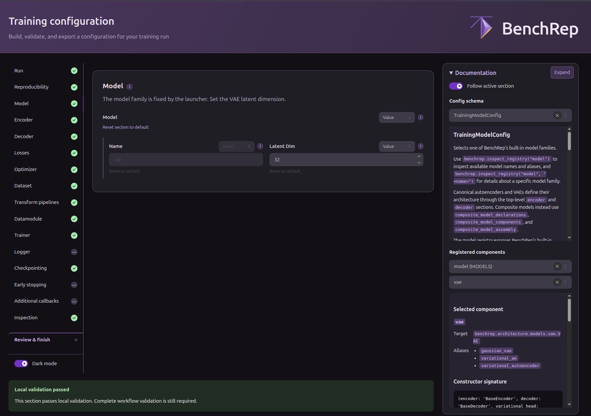
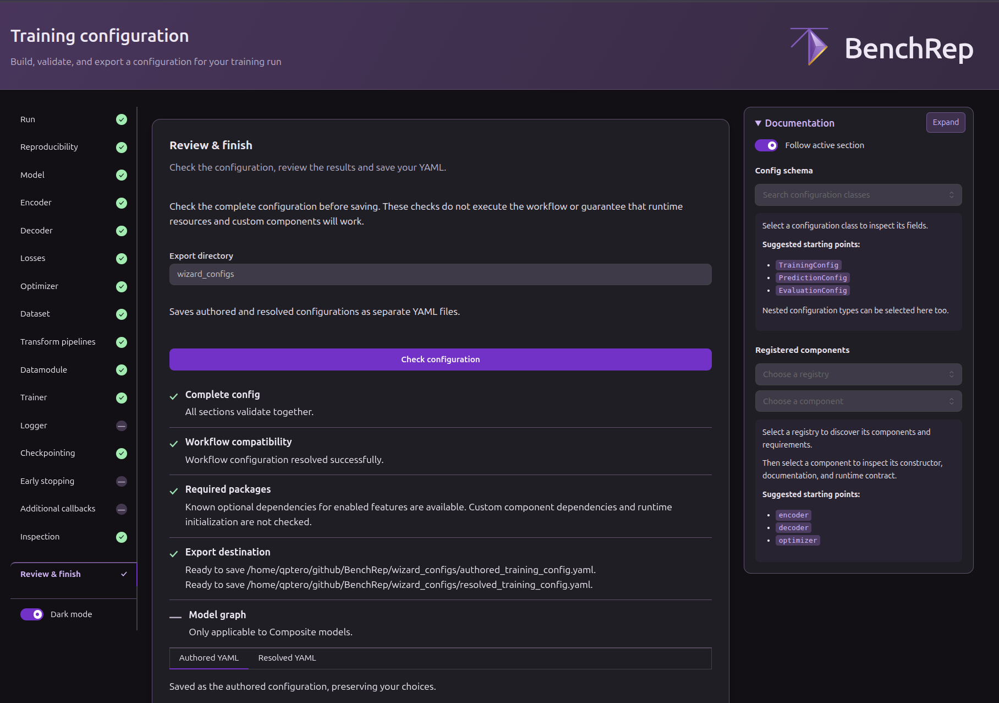

# Configure a workflow in the browser

Use the training wizard to make the same change as in the [YAML guide](yaml.md): start from the packaged MNIST VAE config, change the latent dimension from 32 to 64, and train with the result. The wizard lets you inspect fields, preview your YAML, and check the complete configuration before you run anything.

<strong class="highlight">Requirements.</strong> Install the `gui` extra if you haven’t already:

```bash
python -m pip install "benchrep[gui] @ git+https://github.com/uhlmanngroup/BenchRep.git"
```

## Launch the wizard

```python
from benchrep import configure_workflow, train_vae
from benchrep.examples import example_config_path
from benchrep.interfaces.model_families import VAE_FAMILY

wizard_result = configure_workflow(
    stage="training",
    model_family=VAE_FAMILY,
    config=example_config_path("01_yaml_pipeline", stage="training"),
    export_directory="wizard_configs/mnist-vae-64",
)
```

The launcher opens your browser and prints the local address (by default, <http://127.0.0.1:8050>). To use another port, pass `port=...`.

To start with your own base YAML, pass its path as `config`. Or omit it to start fresh.

For training and prediction, the launcher’s `model_family` determines which model sections you can configure. Here it fixes the model name to VAE. If a base YAML names another family or contains VAE-incompatible sections, the wizard flags the incompatible entries so you can remove them.

## Edit the model section

Select **Model** on the left and change **Latent Dim** to `64`. Open **Preview YAML draft** to see the edit. The **Documentation** panel on the right follows the active section and lets you inspect its schema, registered components, aliases, and constructor signatures.



The field menu distinguishes **Omit** (leave the key out of the YAML), **Null** (write an explicit `null`), **Empty** (supply an empty collection), and **Value** (enter a value). Available choices depend on the field. Omitting, setting to `null`, or setting to `empty` can each produce different behavior. See the Documentation panel for field-specific details.

The sidebar marks locally valid sections in green, errors in red, and valid omitted or null sections with a dash. You can remove unrecognized fields or sections directly in the wizard.

## Review and save

Open **Review & finish** and click **Check configuration** to trigger a workflow-level schema validation and a higher-level validation with a config resolver call. This also checks known dependencies for enabled features, as well as the export destination. This is where a combination of individually valid sections can still fail. Re-checking is required if the draft or export settings are changed.



Compare the **Authored YAML** and **Resolved YAML** tabs. The authored version preserves your choices, including which fields you omitted or set to `null`. The resolved version shows the settings BenchRep derived for this environment.

!!! note "Composite model graph"
    For composite models, **Review & finish** can preview the model wiring before training. To enable the preview, use `benchrep[gui,model_graph]` in the install command above. Run `dot -V` to check whether the Graphviz executable is available. If needed, install [Graphviz for your platform](https://graphviz.org/download/).

Click **Save & finish** to write both YAMLs and return to the Python script.

## Use the result

The call to `configure_workflow()` waits while you edit. Once you save, the next line of the same script can start training with the returned config and overrides:

```python
if wizard_result is not None:
    training = train_vae(
        config=wizard_result.config,
        # Optional here. This forwards any overrides still needed at runtime,
        # such as a custom datamodule supplied to the wizard.
        overrides=wizard_result.overrides,
    )
    print(training.manifest_path)
```

**Cancel** returns `None`, so the snippet skips training. To train later, pass the saved authored YAML path to `train_vae(config=...)`. BenchRep resolves it when the run starts.

## Continue to prediction

After a successful training run, you can open the prediction wizard in the same script. Pass the training manifest through the `overrides` argument to `configure_workflow()`. The wizard uses it during review and returns it in `prediction_wizard_result.overrides`, which you can pass directly to `predict_vae()`.

```python
from benchrep import PredictionOverrides

prediction_wizard_result = configure_workflow(
    stage="prediction",
    model_family=VAE_FAMILY,
    config=example_config_path("01_yaml_pipeline", stage="prediction"),
    overrides=PredictionOverrides(training_manifest_path=training.manifest_path),
)
```

After prediction, use the same `overrides` argument to pass the prediction manifest to the evaluation wizard. The [chained wizard example](https://github.com/uhlmanngroup/BenchRep/blob/main/examples/usage/08B_dual_input_multitask_composite_vae_wizard.py) shows all 3 stages in one script. For more on editing and validation, see [Using the configuration wizards](../usage/wizards.md).
