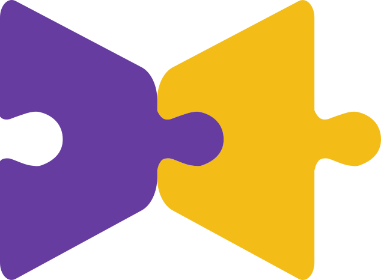

---
hide:
  - navigation
---

  <h1 class="br-home-title">
    
    BenchRep
  </h1>
  
A configuration-driven, Lightning-based, extensible Python <strong class="highlight">workbench for representation learning</strong>.

  

    <strong class="br-intent-title"><svg class="br-icon " aria-hidden="true"><use href="assets/interface-icons.svg#sliders"></use></svg> Experiment</strong>
    
Explore architectures and learning objectives using configurations that simplify repeated runs with targeted changes.

  

  

    <strong class="br-intent-title"><svg class="br-icon " aria-hidden="true"><use href="assets/interface-icons.svg#chart"></use></svg> Benchmark</strong>
    
Compare models reproducibly through linked training, representation export, and standardized evaluation workflows.

  

  

    <strong class="br-intent-title"><svg class="br-icon " aria-hidden="true"><use href="assets/interface-icons.svg#book"></use></svg> Teach</strong>
    
Demonstrate representation learning through configurable experiments with minimal coding overhead.

  

## Design philosophy

> BenchRep provides infrastructure for representation-learning experiments, supporting both beginners and experienced researchers. It offers structure through extensive configurability and multiple layers of validation, while still leaving room for users to define or bring their own methods and bypass some guardrails when needed. Its design prioritizes flexibility, reproducibility, and traceability, to make experiments easier to design, run, understand, compare, and reproduce.

## Get started

<nav class="br-start" aria-label="Getting started">
  <a class="br-start-link" href="guides/installation.md">
    <svg class="br-icon " aria-hidden="true"><use href="assets/interface-icons.svg#download"></use></svg>
    <strong>Install BenchRep</strong>
    Choose the optional dependencies you need.
  </a>
  <a class="br-start-link br-start-link--primary" href="guides/first-workflow-chain.md">
    <svg class="br-icon " aria-hidden="true"><use href="assets/interface-icons.svg#play"></use></svg>
    <strong>Run your first workflow chain</strong>
    Train a VAE, export embeddings and reconstructions, and evaluate them.
  </a>
  <a class="br-start-link" href="guides/standalone-evaluation.md">
    <svg class="br-icon " aria-hidden="true"><use href="assets/interface-icons.svg#chart"></use></svg>
    <strong>Evaluate external outputs</strong>
    Start with existing embeddings or reconstructions and go straight to evaluation.
  </a>
</nav>

## How BenchRep works

BenchRep organizes experiments into 3 configurable workflows: training, prediction, and evaluation. Run them as a linked chain, reuse earlier runs, or evaluate outputs produced outside BenchRep. 

Training fits a model and saves checkpoints. Prediction uses a trained model to export embeddings, reconstructions, or both. Evaluation measures properties such as clustering quality, predictability, and reconstruction error.

<figure>
  
  
  <figcaption>Dash-dot arrows mark optional connections. Wands mark configuration wizards.</figcaption>
</figure>

Each workflow takes a config, runs independently, and writes a manifest. To chain the three, pass an upstream manifest path to a downstream workflow. This lets you trace an evaluation result back to its training and prediction settings.

Each run also saves its resolved configuration, runtime environment, logs, and status report, showing which settings took effect, which steps completed, and where warnings or failures occurred. In Python, each workflow also returns a result object for inspecting outputs or continuing programmatically.

## Configure your experiment

Each workflow has its own configuration, describing the components and settings it needs. You can write a workflow config in **YAML**, build it in **Python**, or use the **browser wizard** to explore the available fields and export a YAML. 

Configs refer to registered components by name. You can inspect registries and, where supported, register your own classes or factories. Once registered, custom components such as datasets and losses can be selected by name just like built-in ones.

The **canonical families**, [autoencoder (AE)](concepts/models/canonical.md#autoencoder) and [variational autoencoder (VAE)](concepts/models/canonical.md#variational-autoencoder), provide predefined model structures with configurable encoders and decoders. Among the The **non-canonical families**, the [Composite family](concepts/models/composite.md) lets you declare components, connections, and loss inputs to build multi-input and multitask models directly in config. The [YOYO family](concepts/models/yoyo.md) accepts a complete LightningModule class or instance through Python, including already-trained models; you take responsibility for compatibility with the data and selected outputs.

<strong class="highlight">Want to compare two encoders?</strong>
Change the encoder section in your canonical training YAML, keeping its interface compatible, and rerun the same workflow chain.

<strong class="highlight">Want to tune architectures or hyperparameters?</strong> Use Optuna to choose what to try. For each trial, use [`update_config()`][benchrep.update_config] to change individual fields or pass whole config sections through a workflow’s overrides object. To prune during training, pass Optuna’s Lightning callback via `runtime_callbacks`.

<strong class="highlight">Want more control and flexibility?</strong>
Explore custom architectures and learning objectives, combine built-in and external components, or bring your own complete model and data pipeline. Train from scratch, build on pretrained weights, or benchmark an existing model without retraining it.

## Explore the docs

<nav class="br-doc-routes" aria-label="Documentation sections">
  <a class="br-doc-route" href="guides/index.md">
    <svg class="br-icon " aria-hidden="true"><use href="assets/interface-icons.svg#route"></use></svg>
    <strong>Tutorials</strong><small>Configuration routes, external components, composite models, and hyperparameter tuning through concrete examples.</small>
    <svg class="br-icon br-route-arrow" aria-hidden="true"><use href="assets/interface-icons.svg#arrow"></use></svg>
  </a>
  <a class="br-doc-route" href="concepts/index.md">
    <svg class="br-icon " aria-hidden="true"><use href="assets/interface-icons.svg#gear"></use></svg>
    <strong>Concepts &amp; design</strong><small>How BenchRep builds models, runs workflows, and records results, with a map of the code behind each feature.</small>
    <svg class="br-icon br-route-arrow" aria-hidden="true"><use href="assets/interface-icons.svg#arrow"></use></svg>
  </a>
  <a class="br-doc-route" href="reference/index.md">
    <svg class="br-icon " aria-hidden="true"><use href="assets/interface-icons.svg#code"></use></svg>
    <strong>Reference</strong><small>Lookup pages for public APIs, configuration fields, and registered components.</small>
    <svg class="br-icon br-route-arrow" aria-hidden="true"><use href="assets/interface-icons.svg#arrow"></use></svg>
  </a>
</nav>

BenchRep is under active development. Its public interfaces and configuration schemas may change before version 1.0.

