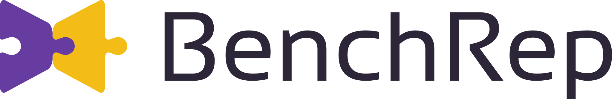
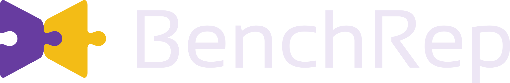
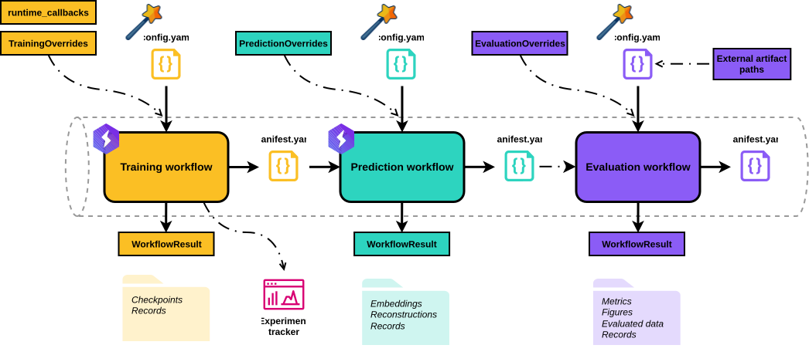
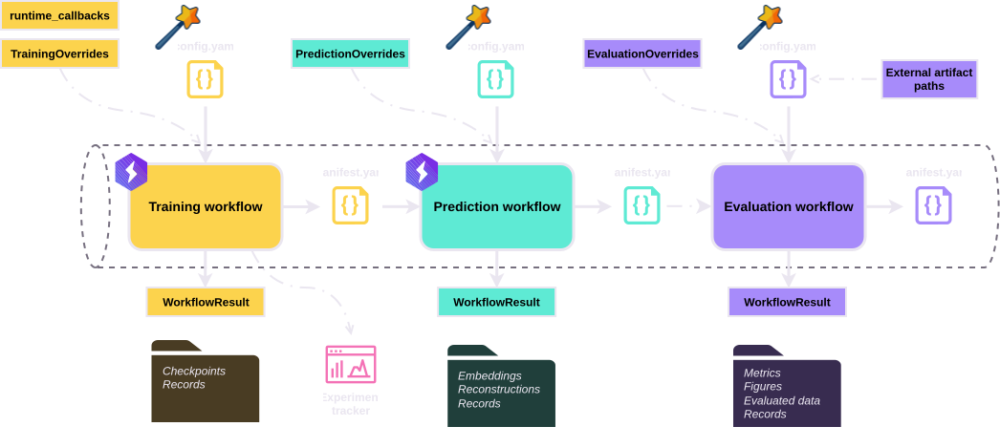

---
hide:
  - navigation
---

  <h1 class="br-home-title">
    
    
  </h1>

BenchRep is a configuration-driven, Lightning-based, extensible Python workbench for representation learning.

  

    <strong class="br-intent-title"><svg class="br-icon " aria-hidden="true"><use href="assets/interface-icons.svg#sliders"></use></svg> Experiment</strong>
    
Explore architectures and objectives using configurations that simplify repeated runs with targeted changes.

  

  

    <strong class="br-intent-title"><svg class="br-icon " aria-hidden="true"><use href="assets/interface-icons.svg#chart"></use></svg> Benchmark</strong>
    
Compare models reproducibly through linked training, representation export, and standardized evaluation workflows.

  

  

    <strong class="br-intent-title"><svg class="br-icon " aria-hidden="true"><use href="assets/interface-icons.svg#book"></use></svg> Teach</strong>
    
Demonstrate representation learning through configurable experiments with minimal coding overhead.

  

## Design philosophy

> BenchRep provides infrastructure for representation-learning experiments, supporting beginners and experienced researchers. It offers structure through extensive configurability and multiple layers of validation, while leaving room for users to define or bring their own methods and bypass some guardrails when needed. Its design prioritizes flexibility, reproducibility, and traceability, to make experiments easier to design, run, understand, compare, and reproduce.

## Get started

<nav class="br-start" aria-label="Getting started">
  <a class="br-start-link" href="guides/installation.md">
    <svg class="br-icon " aria-hidden="true"><use href="assets/interface-icons.svg#download"></use></svg>
    <strong>Install BenchRep</strong>
    Choose the optional dependencies you need.
  </a>
  <a class="br-start-link br-start-link--primary" href="guides/first-workflow-chain.md">
    <svg class="br-icon " aria-hidden="true"><use href="assets/interface-icons.svg#play"></use></svg>
    <strong>Run your first workflow chain</strong>
    Train a VAE, export embeddings and reconstructions, and evaluate them.
  </a>
  <a class="br-start-link" href="guides/standalone-evaluation.md">
    <svg class="br-icon " aria-hidden="true"><use href="assets/interface-icons.svg#chart"></use></svg>
    <strong>Evaluate external outputs</strong>
    Start with existing embeddings or reconstructions and go straight to evaluation.
  </a>
</nav>

## How BenchRep works

BenchRep organizes experiments into 3 configurable workflows: training, prediction, and evaluation. Run them as a linked chain, reuse earlier runs, or start directly from a supplied model or externally produced outputs.

Training fits a model and saves checkpoints. Prediction runs a model to export embeddings, reconstructions, or both. Evaluation measures properties such as clustering quality, predictability, and reconstruction error.

<figure>
  
  
  <figcaption>Dash-dot arrows mark optional connections. Wands mark configuration wizards. Prediction can skip the training manifest for certain supplied models.</figcaption>
</figure>

Each workflow takes a config, returns a Python result, and saves run records, including a manifest, resolved configuration, runtime environment, logs, and status information. To link runs, pass the previous run’s manifest path to the next workflow.

## Configure and customize

Write a workflow config in **YAML**, build it in **Python**, or use the **browser wizard** to explore the available fields and export a YAML file.

Configs select registered components by name. Inspect the registries to see what’s available or, where supported, register your own datasets, losses, or other components and select them the same way.

BenchRep has 4 model families. Each defines how you configure or supply a model, what interface it must follow, and how BenchRep interprets its outputs.

<figure style="width: 640px; max-width: 100%; margin-inline: auto;">
  
  
  <figcaption style="width: 100%; max-width: none; margin-inline: auto; box-sizing: border-box;">
  Composite offers the most control in config. YOYO gives you the most freedom to supply a model. AE and VAE support both routes within family contracts.
</figcaption>
</figure>

- The **canonical families**, [autoencoder (AE)](concepts/models/canonical.md#autoencoder) and [variational autoencoder (VAE)](concepts/models/canonical.md#variational-autoencoder), provide predefined model structures with configurable encoders and decoders. They also accept compatible model implementations.
- The **non-canonical families** offer two other routes. [Composite](concepts/models/composite.md) lets you choose components and wire their connections and losses in config. [YOYO (You're On Your Own)](concepts/models/yoyo.md) requires a complete `LightningModule` class or instance. You’re responsible for matching it to your data and chosen outputs.

<strong class="highlight">Want to compare two encoders?</strong>
Swap the encoder in your AE or VAE config and rerun the workflow chain.

<strong class="highlight">Want to tune architectures or hyperparameters?</strong>
[Use Optuna](guides/optuna.md) to vary settings across trials from a shared base config.

<strong class="highlight">Already have a trained model?</strong>
Use it as a starting point for fine-tuning, or [use YOYO to benchmark it without retraining](guides/bring-your-own-model-or-datamodule.md#predict-with-a-pretrained-model).

## Explore the docs

<nav class="br-doc-routes" aria-label="Documentation sections">
  <a class="br-doc-route" href="guides/index.md">
    <svg class="br-icon " aria-hidden="true"><use href="assets/interface-icons.svg#route"></use></svg>
    <strong>Tutorials</strong><small>Worked examples for configuring workflows; building, tuning, and benchmarking models; and evaluating results.</small>
    <svg class="br-icon br-route-arrow" aria-hidden="true"><use href="assets/interface-icons.svg#arrow"></use></svg>
  </a>
  <a class="br-doc-route" href="concepts/index.md">
    <svg class="br-icon " aria-hidden="true"><use href="assets/interface-icons.svg#gear"></use></svg>
    <strong>Concepts &amp; design</strong><small>How BenchRep builds models, runs workflows, and records results, with a map of the code behind each feature.</small>
    <svg class="br-icon br-route-arrow" aria-hidden="true"><use href="assets/interface-icons.svg#arrow"></use></svg>
  </a>
  <a class="br-doc-route" href="reference/index.md">
    <svg class="br-icon " aria-hidden="true"><use href="assets/interface-icons.svg#code"></use></svg>
    <strong>Reference</strong><small>Lookup pages for public APIs, configuration fields, and registered components.</small>
    <svg class="br-icon br-route-arrow" aria-hidden="true"><use href="assets/interface-icons.svg#arrow"></use></svg>
  </a>
</nav>

BenchRep is under active development. Its public interfaces and configuration schemas may change before version 1.0.

