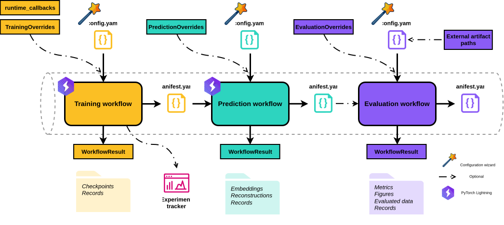

# BenchRep

BenchRep is a configuration-driven, Lightning-based framework for training representation-learning models, exporting their learned representations, and evaluating those representations through reproducible, linked workflows. You can reuse a <strong class="highlight">benchmark</strong> across models, <strong class="highlight">experiment</strong> with architectures and learning objectives, or <strong class="highlight">teach</strong> representation learning through a configuration wizard.

## Start here

- **[Install BenchRep](guides/installation.md)** and choose the optional dependencies you need.
- **[Run your first workflow chain](guides/first-workflow-chain.md)** to train a VAE, export embeddings and reconstructions, and evaluate them.
- **[Evaluate external embeddings or reconstructions](guides/standalone-evaluation.md)** if you already have model outputs and want to go straight to evaluation.

## Workflows and provenance

Training fits a model and saves checkpoints. Prediction uses a trained model to export embeddings, reconstructions, or both. Evaluation measures properties such as clustering quality, predictability, and reconstruction error.

<figure>
  
  <figcaption>Dash-dot arrows mark optional connections. Wands mark configuration wizards.</figcaption>
</figure>

Each workflow takes a config, runs independently, and writes a manifest. To chain the three, pass an upstream manifest path to a downstream workflow. This lets you trace an evaluation result back to its training and prediction settings.

Each run also saves its resolved configuration, runtime environment, logs, and status report, showing which settings took effect, which steps completed, and where warnings or failures occurred. In Python, each workflow returns a result object. For example, you can read a clustering score directly from the evaluation result using the same keys shown in the exported `metrics.json`.

## Configuring an experiment

You can write a workflow config in <strong class="highlight">YAML</strong>, build it in <strong class="highlight">Python</strong>, or use the <strong class="highlight">browser wizard</strong> to explore the available fields and export a YAML. Configs refer to registered components by name. You can inspect registries and, where supported, register your own classes or factories. Once registered, custom components such as datasets and losses can be selected by name just like built-in ones.

For training, a [canonical autoencoder or VAE](usage/canonical-models.md) gives you a predefined architecture with your choice of encoder and decoder. With a [composite model](usage/composite-models.md), you specify which components to use, how they connect, and which values feed each loss. This lets you build multi-input and multitask models directly in config.

<strong class="highlight">Want to compare two encoders?</strong>
Change just the encoder section in your canonical training YAML and rerun the same workflow chain.

<strong class="highlight">Want to tune architectures or hyperparameters?</strong> Use Optuna to choose what to try. For each trial, use `update_config()` to change individual fields or pass whole config sections through a workflow’s overrides object. To prune during training, pass Optuna’s Lightning callback via `runtime_callbacks`.

<strong class="highlight">Want more control over the model or training objective?</strong>
Register your own components, wire them into a composite model, and define a custom loss with access to the full model context. You can also supply a model or datamodule instance or class through overrides where supported.

## Explore the docs

- **[Guides & tutorials](guides/index.md)** walk through tasks such as configuring a run in the wizard, building a multitask model, and tuning hyperparameters with Optuna.
- **[Using BenchRep](usage/index.md)** explains how to write configs, call workflows, inspect results, and register your own components.
- **[How BenchRep works](internals/index.md)** follows a run from config validation and resolution through execution, artifact export, and provenance tracking.
- **[API reference](reference/index.md)** is where to look up the signatures and parameters of public functions and classes.

BenchRep is under active development. Its public interfaces and configuration schemas may change before version 1.0.
