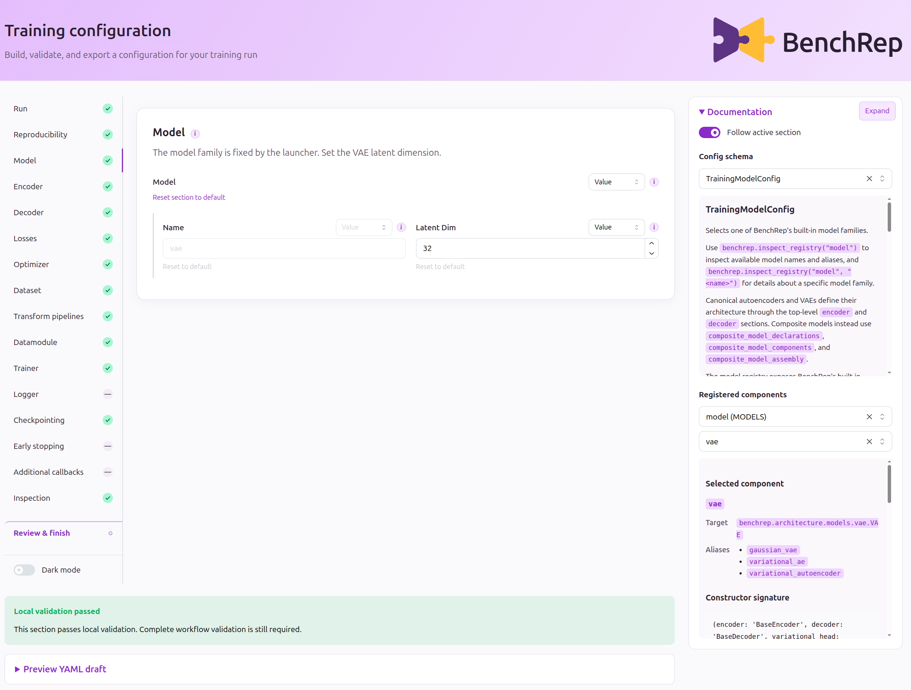
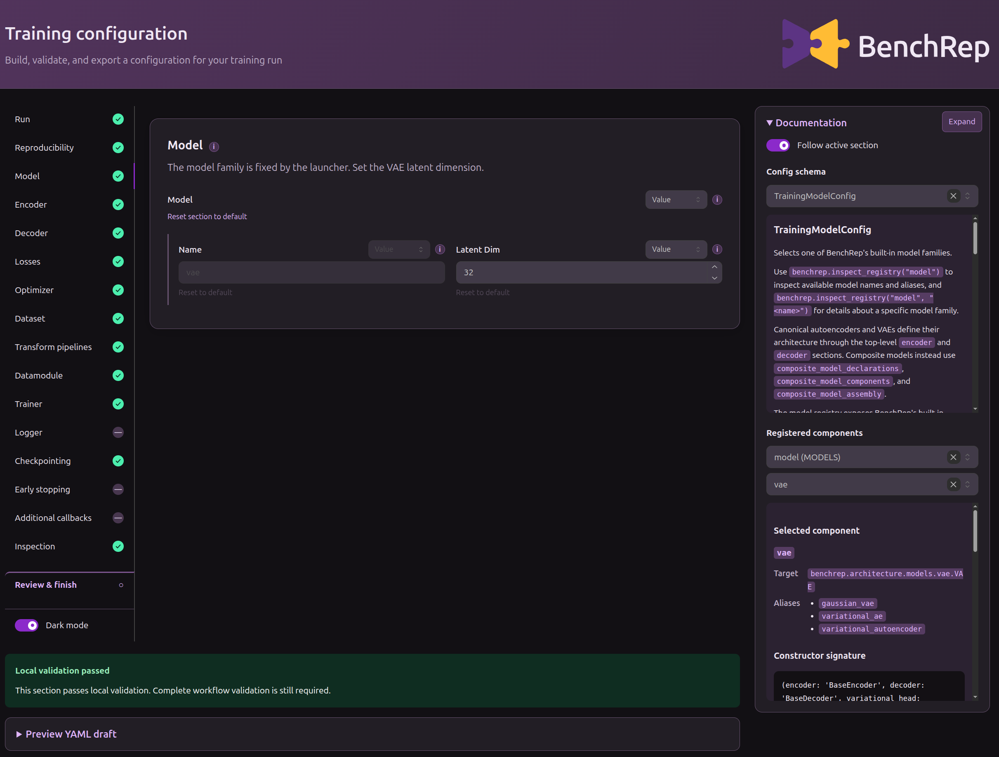
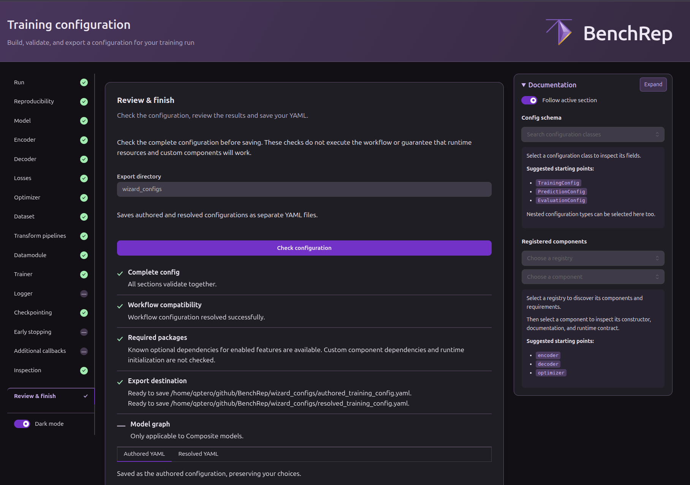

# Configuration wizards

The wizard makes a configuration's structure visible: you can explore sections, inspect registered components, and check how choices fit together before running a workflow. It edits the same configuration consumed by the Python entrypoints and YAML-based runs.

The wizard **authors and reviews** a configuration; it does not train, predict, or evaluate. For a runnable walkthrough, see [Configure workflows](../../guides/configure-workflows/index.md#browser-wizard).

## Start from a draft or a blank configuration

[`configure_workflow()`][benchrep.configure_workflow] accepts a stage, an optional base config, and an optional overrides object. A base YAML can be incomplete or contain invalid entries: opening it for editing does not require a successful workflow run or a fully valid draft.

For training and prediction, the launcher's `model_family` controls which model sections are appropriate. It defaults to composite; use `AUTOENCODER_FAMILY` or `VAE_FAMILY` for a canonical model. The family is fixed for that wizard session, so an incompatible model name or section in the base YAML is flagged rather than silently changing families. Evaluation has no model family.

The launcher starts a local server and normally opens the browser at <http://127.0.0.1:8050>. The calling Python script waits until you finish or cancel; `port` and `open_browser` control the browser connection.

## Edit with the schema beside you

The editor organizes fields by section. Its **Documentation** panel follows the selected section and exposes schema descriptions, registered components, aliases, and constructor signatures. **Preview YAML draft** shows the current authored settings without starting execution.

<figure>
  <a class="br-image-light" href="../../assets/configuration-wizard-light.png">
    
  </a>
  <a class="br-image-dark" href="../../assets/configuration-wizard-dark.png">
    
  </a>
  <figcaption>The editor and discovery panel expose the configuration and its documentation together.</figcaption>
</figure>

Field menus distinguish **Omit**, **Null**, **Empty**, and **Value** where supported. These preserve different authored choices; their effects are defined by the field, as explained in [Configuration semantics](configuration.md#omitted-null-and-empty-are-different-inputs).

The sidebar marks local validity in green, issues in red, and valid omitted or null sections with a neutral dash. Unexpected fields or sections remain visible so you can remove them. These indicators describe the current local state, not whether the complete experiment is executable.

## Review the complete configuration

**Review & finish → Check configuration** evaluates the draft as a whole:

| Check | What it establishes |
| --- | --- |
| Schema validation | The composed draft satisfies the workflow schema, including schema-level relationships |
| Resolution | Sections, selected components, applicable upstream information, and runtime override requirements fit together |
| Dependencies | Known dependencies for enabled features are available, or their absence is reported |
| Export destination | The authored and resolved YAMLs can be saved to the selected locations without overwriting existing files |

A collection of locally valid sections can still fail here. Changes to the draft or export settings require another check before saving.

[](../../assets/guides/configuration-wizard/review-and-finish.png)

<small class="br-caption">Review separates the validation results from the authored and resolved YAML previews.</small>

The **Authored YAML** preserves the choices in the draft, including omissions and explicit nulls. The **Resolved YAML** shows the interpretation produced during review. For composite configurations, review can also preview the specification graph to inspect declared wiring without constructing or training the model; this requires Graphviz.

??? note "What a successful review does not guarantee"
    Review does not instantiate and exercise every component. It cannot establish that all custom dependencies are available, that real batches satisfy every runtime expectation, or that the run will fit in memory. Some optional outputs, such as an unavailable graph preview, can produce a warning without blocking configuration export. Execution still performs its own checks.

## Save and continue in Python

**Save & finish** writes authored and resolved YAMLs and returns a [`ConfiguredWorkflow`][benchrep.gui.shared.results.ConfiguredWorkflow]. **Cancel** returns `None`.

| Returned value | Use |
| --- | --- |
| `config` and `overrides` | Execute the configured workflow in the current Python process |
| `config_path` | Run later from the saved authored YAML, supplying any required runtime objects again |
| `authored_config` | Inspect the authored mapping, including omitted versus explicit values |
| `resolved_config` and `resolved_config_path` | Inspect the interpretation produced during review |

After a training wizard launched for the VAE family, the same script can continue with:

```python
from benchrep import train_vae

if wizard_result is not None:
    training_result = train_vae(
        config=wizard_result.config,
        overrides=wizard_result.overrides,
    )
```

Use the authored configuration for subsequent execution so BenchRep can resolve it in that run's context. A review snapshot can depend on the environment and upstream artifacts available when it was checked.

## Overrides enter and leave the wizard

The wizard accepts the same workflow-specific override bundles described in [Python overrides](overrides.md). For example, launch a prediction wizard with `overrides=PredictionOverrides(training_manifest_path=training_result.manifest_path)` to review it against the run you just trained.

Section overrides become part of the editable draft and are removed from the returned override bundle. Other inputs needed at execution, including runtime objects and supplied manifest overrides, are retained. Forwarding both `wizard_result.config` and `wizard_result.overrides` preserves that combination without applying the original section replacements over your edits again.

For how the editor preserves draft state and manages review internally, see [How the wizard works](../internals/wizard-architecture.md).
