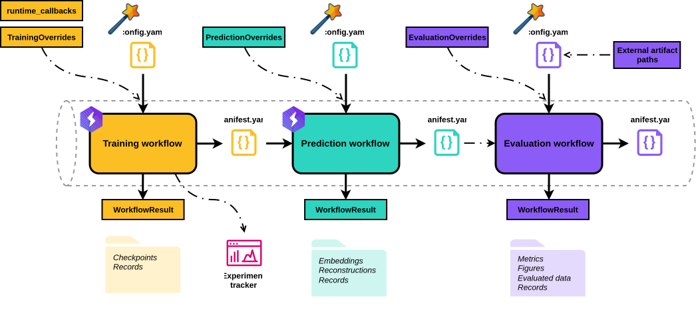
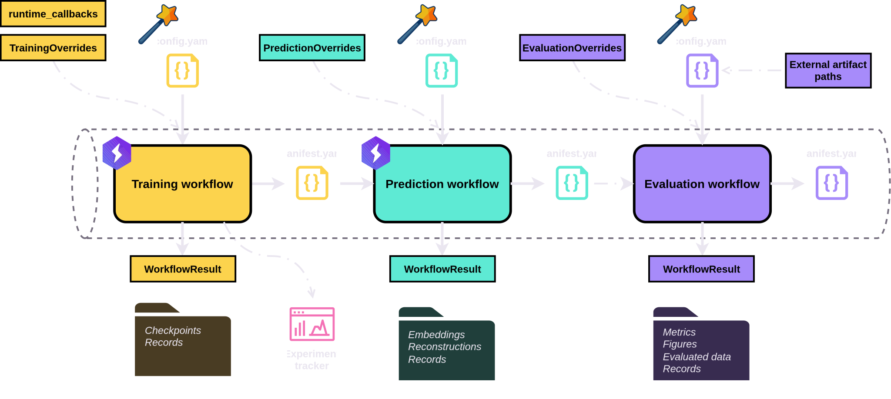

# Workflows and model families

BenchRep separates fitting a model, exporting its predictions, and evaluating those outputs into **3 independently configured workflows**. This lets you reuse a checkpoint for different prediction runs, evaluate the same embeddings with different methods, or evaluate outputs produced outside BenchRep.

## What a workflow owns

| Workflow | Main inputs | Main responsibility | Typical outputs |
| --- | --- | --- | --- |
| Training | Model, data, and training settings; supported runtime overrides | Fit a model | Checkpoints and training records |
| Prediction | Training manifest, checkpoint selection, and prediction settings | Run inference and export selected outputs | AnnData embeddings and reconstruction bundles |
| Evaluation | Prediction manifest or external artifact paths, plus analysis settings | Analyze the exported data | Metrics, figures, and evaluated data |

Each workflow manages its own run directory and returns a Python result containing its config, run context, status report, and manifest path. Stage-specific fields expose objects such as the trained model or evaluated AnnData. See [Results and statuses](../../reference/results.md).

<figure>
  
  
  <figcaption>Each stage is a separate call. Dash-dot arrows mark optional connections; wands mark configuration wizards.</figcaption>
</figure>

## How runs connect

A manifest records a run's settings, artifact locations, and provenance. Prediction reads the training manifest to identify the model construction and checkpoint; evaluation can read the prediction manifest to locate its exported data. Linked records retain upstream information so results can be traced back through the chain.

The connection is a **manifest path**, not a requirement that all stages share one Python process. You can run them consecutively in a script or launch a later stage using an existing manifest. External registrations and runtime implementations must still be available in the process that needs them.

Prediction requires a training manifest even when you supply a model override. Evaluation can instead start from external embeddings or reconstructions, without a BenchRep training or prediction run. See [Loading models for prediction](../prediction/loading-models.md), [Evaluation inputs](../evaluation/inputs.md), and [Manifests and provenance](../results/provenance.md).

## Stage and family are separate choices

The **stage** determines the work to perform. The **model family** determines the model's construction and runtime contracts for training and prediction.

| Family | Training / prediction entrypoints | Configuration-built architecture |
| --- | --- | --- |
| Autoencoder | `train_ae()` / `predict_ae()` | Encoder → decoder |
| VAE | `train_vae()` / `predict_vae()` | Encoder → variational head → decoder |
| Composite | `train_composite()` / `predict_composite()` | Declared components and their execution graph |

For a config-built model, the selected family must agree with the model named in configuration; registered aliases still select the same family. Changing `vae` to `composite` is therefore more than a name change: it changes the architecture description and contracts BenchRep expects.

Canonical models allow your choice of compatible encoder and decoder within their predefined topology. Composite models let you declare connections and loss inputs. For the architectural details, see [Canonical models](../models/canonical.md) and [Composite models](../models/composite.md).

`evaluate()` has no model-family argument: it consumes artifacts rather than executing the model that produced them.

## Configuration does not own every implementation

A workflow normally builds components from registered names and parameters. Training and prediction can also accept a model or datamodule supplied in Python, while preserving the surrounding workflow's records and execution machinery.

Whole-model overrides are supported for the 2 canonical families; datamodule overrides are supported for all 3. This is distinct from registering an encoder, loss, or dataset that BenchRep will build from config. See [Python overrides](overrides.md) and [Registering components](../extensibility/registration.md).
